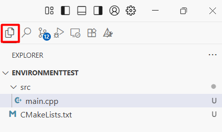
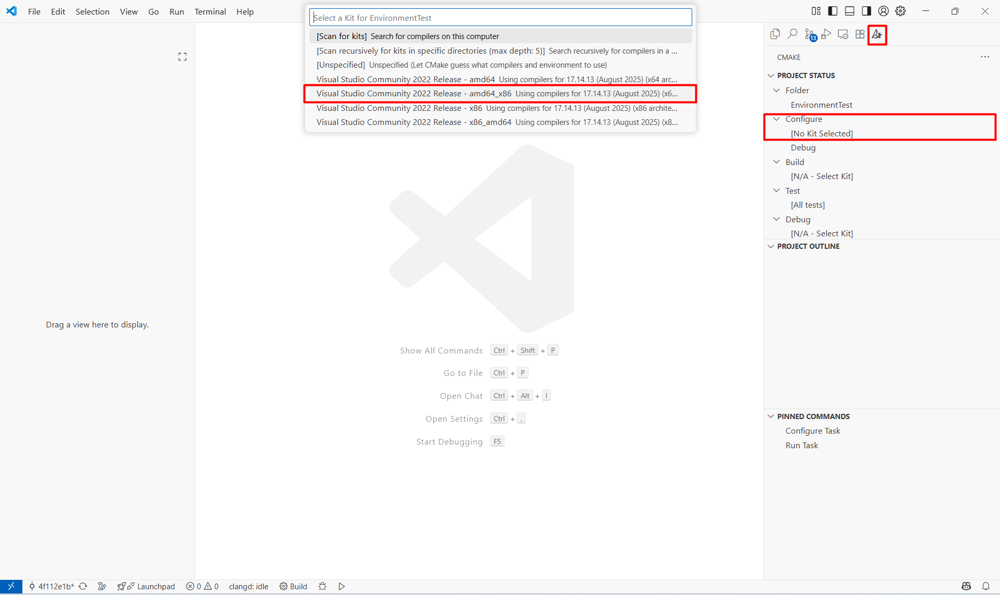
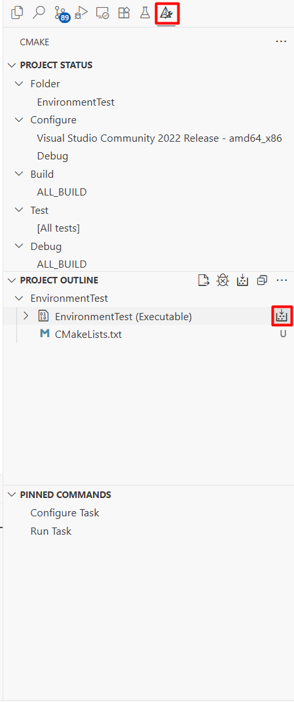

# Измерение производительности (Benchmark)

Цель лабораторной работы -- научиться измерять время выполнения кода на C++ средствами стандартной библиотеки (**std::chrono**), корректно ставить эксперимент и сравнивать алгоритмы и структуры данных по производительности. Результаты измерений сопоставляются с теоретической оценкой сложности (O-нотацией).

Перед выполнением работы необходимо:

- настроить окружение по мануалу [Настройка окружения под Windows/Linux](../../EnvironmentTest/manual/environment.md);
- выполнить лабораторную работу [Базовое модульное тестирование](../../BasicUT/manual/basic_ut.md) -- в этой работе используется тот же подход с тестовым раннером (**CFixture**).

## Подготовка

Проект **Benchmark** самостоятельный: он конфигурируется и собирается отдельно от остальных лабораторных работ и не требует сторонних библиотек и переменной окружения **WORKSDK**.

### Получение исходников

1. Обновить личный репозиторий (Pull) в Git-клиенте (Git Extensions / Sublime Merge).
2. Убедиться, что в репозитории присутствует папка **Benchmark**.

## Тестовый проект

Структура проекта:

```
aip
    ...
    Benchmark
        manual
            benchmark.md
        src
            main.cpp
            Sorting.h
            Timer.h
            Timer.cpp
        tests
            testMain.cpp
        CMakeLists.txt      <- самостоятельный CMake-проект
    ...
```

### Timer.h / Timer.cpp -- таймер

**CTimer** -- таймер, построенный по идиоме **RAII**: время начала фиксируется в конструкторе, а в деструкторе вычисляется и выводится длительность. Таким образом, измеряется время жизни объекта, т.е. код от объявления таймера до конца блока **{ }**.

```
class CTimer
{
    public:
        CTimer();   // Запоминает момент старта

        ~CTimer();  // Выводит "Duration: <N> microseconds"

    private:
        std::chrono::high_resolution_clock::time_point m_startTime;
};
```

Пример использования:

```
{
    auto vec = GenerateIntVector(1000, 0, 1000); // Подготовка данных -- НЕ входит в замер
    NBenchmark::CTimer timer;                    // Старт замера
    NBenchmark::BubbleSortClassic(vec);
}                                                // Деструктор timer -- конец замера и вывод
```

### Sorting.h -- исследуемые алгоритмы

Заголовочный файл содержит шаблонные функции сортировки в пространстве имен **NBenchmark**:

- **BubbleSortClassic** -- классическая сортировка пузырьком, сложность **O(n²)** в любом случае;
- **StdSort** -- обертка над **std::sort**, сложность **O(n log n)**.

```
template<typename T>
void BubbleSortClassic(std::vector<T>& arr)
{
    const size_t n = arr.size();
    if (n < 2)
    {
        return; // Для пустого вектора n - 1 переполнило бы size_t
    }

    for (size_t i = 0; i < n - 1; ++i)
    {
        for (size_t j = 0; j < n - 1; ++j)
        {
            if (arr[j] > arr[j + 1])
            {
                std::swap(arr[j], arr[j + 1]);
            }
        }
    }
}
```

Функции шаблонные, поэтому реализация находится в заголовке, а не в .cpp-файле.

### testMain.cpp -- раннер бенчмарков

Раннер устроен так же, как в лабораторной работе BasicUT, с несколькими отличиями:

**Генераторы данных** -- функции, создающие вектор случайных значений заданного размера и диапазона:

```
std::vector<int>         GenerateIntVector(size_t size, int minVal, int maxVal);
std::vector<double>      GenerateDoubleVector(size_t size, double minVal, double maxVal);
std::vector<std::string> GenerateStringVector(size_t size, int minStringSize, int maxStringSize);
```

**CTestCase** -- именованный тестовый случай: имя + функция, возвращающая **int** (0 -- успех).

**CFixture** -- набор тестовых случаев. Запускает их по очереди, выводит имя каждого случая и итоговую статистику.

**SortIntVector** -- сценарий замера: для одного и того же размера сортирует случайный вектор двумя алгоритмами и выводит время каждого.

```
int SortIntVector(size_t size, int minVal, int maxVal)
{
    {
        auto vec = GenerateIntVector(size, minVal, maxVal);
        NBenchmark::CTimer timer;
        NBenchmark::BubbleSortClassic(vec);
    }

    {
        auto vec = GenerateIntVector(size, minVal, maxVal);
        NBenchmark::CTimer timer;
        NBenchmark::StdSort(vec);
    }

    return 0;
}
```

### main.cpp -- консольное приложение

Заготовка приложения (пустая функция **main**). Используется в заданиях, где требуется запуск бенчмарка с параметрами командной строки.

### Benchmark/CMakeLists.txt

Проект самостоятельный: в начале файла задаются минимальная версия CMake, имя проекта, стандарт C++17 и подключается модуль CTest. Далее описываются две цели сборки: приложение **Benchmark** и раннер **BenchmarkUTRunner**.

```
cmake_minimum_required(VERSION 3.10)

project(Benchmark)

set(CMAKE_CXX_STANDARD 17)
set(CMAKE_CXX_STANDARD_REQUIRED ON)

include(CTest)

set(Benchmark_SRCS
    src/main.cpp
    src/Timer.cpp
    src/Timer.h
    src/Sorting.h
)

add_executable(Benchmark
    ${Benchmark_SRCS}
)

# Tests
set(BenchmarkUT_SRCS
    tests/testMain.cpp
    src/Timer.cpp
    src/Sorting.h
)

add_executable(BenchmarkUTRunner
    ${BenchmarkUT_SRCS}
)
```

## Конфигурация, сборка и запуск

1. Открыть в vscode папку проекта **Benchmark** (aip/Benchmark), а не корень репозитория.

2. Выполнить конфигурацию с помощью CMake.

3. Выбрать конфигурацию сборки **Release** (панель CMake -- Configure/Build variant, или строка состояния vscode). Это важно -- см. раздел [Debug или Release](#debug-или-release).
4. Выполнить сборку кнопкой **Build**. Будут собраны обе цели: **Benchmark** и **BenchmarkUTRunner**.


Сборка из терминала (из папки Benchmark):

```
cmake -S . -B build
cmake --build build --config Release --target BenchmarkUTRunner
```

На Linux (одноконфигурационные генераторы Makefiles/Ninja) тип сборки задается при конфигурации:

```
cmake -S . -B build -DCMAKE_BUILD_TYPE=Release
cmake --build build --target BenchmarkUTRunner
```

Расположение исполняемых файлов:

| ОС | Приложение | Раннер бенчмарков |
|---|---|---|
| Windows (Visual Studio) | build\Release\Benchmark.exe | build\Release\BenchmarkUTRunner.exe |
| Linux (Makefiles/Ninja) | build/Benchmark | build/BenchmarkUTRunner |

### Запуск раннера

Windows:

```
.\build\Release\BenchmarkUTRunner.exe
```

Linux:

```
./build/BenchmarkUTRunner
```

Пример вывода (конкретные числа зависят от компьютера и меняются от запуска к запуску):

```
Running 3 tests...
--------------------------------
Test Test1 (size: 1000, minVal: 0, maxVal: 1000)
--------------------------------
Duration: 675 microseconds
Duration: 36 microseconds
[PASS] Test Test1 (size: 1000, minVal: 0, maxVal: 1000)
--------------------------------
Test Test2 (size: 5000, minVal: 0, maxVal: 1000)
--------------------------------
Duration: 13223 microseconds
Duration: 180 microseconds
[PASS] Test Test2 (size: 5000, minVal: 0, maxVal: 1000)
--------------------------------
Test Test3 (size: 100, minVal: 10'000'000, maxVal: 100'000'000)
--------------------------------
Duration: 10 microseconds
Duration: 2 microseconds
[PASS] Test Test3 (size: 100, minVal: 10'000'000, maxVal: 100'000'000)
Results: 3 passed, 0 failed
```

Первая строка **Duration** в каждом тесте -- **BubbleSortClassic**, вторая -- **std::sort**.

Обратите внимание: при увеличении размера с 1000 до 5000 (в 5 раз) время пузырьковой сортировки выросло примерно в 20--25 раз (ожидаемо для O(n²): 5² = 25), а время **std::sort** -- примерно в 5 раз (O(n log n)).

Окружение воспроизведено! Можно приступать к выполнению заданий.

## Рекомендации по проведению замеров

### Debug или Release

Замеры производительности выполняются **только в Release**. В Debug оптимизации отключены, добавлены проверки итераторов и т.п., поэтому результаты искажаются в разы и непропорционально для разных алгоритмов. Тот же запуск в Debug:

| Тест | Bubble, Debug | Bubble, Release | std::sort, Debug | std::sort, Release |
|---|---|---|---|---|
| size 1000 | 7310 мкс | 675 мкс | 143 мкс | 36 мкс |
| size 5000 | 194941 мкс | 13223 мкс | 738 мкс | 180 мкс |

### Правила корректного эксперимента

1. **Одинаковые входные данные.** Сравниваемые алгоритмы должны получать *одинаковые* данные. В исходном **SortIntVector** каждый алгоритм получает свой случайный вектор -- это допустимо для больших размеров, но для честного сравнения лучше сгенерировать вектор один раз и передавать каждому алгоритму его **копию**.
2. **Подготовка данных не входит в замер.** Генерация и копирование данных выполняются до создания таймера.
3. **Повторы.** Однократный замер ненадежен: на результат влияют другие процессы, кэш процессора, частота CPU. Повторяйте замер несколько раз (5--10) и используйте **минимум** или **медиану**.
4. **Достаточная длительность.** Замеры короче ~100 мкс малоинформативны (см. Test3). Для маленьких входов выполняйте алгоритм в цикле много раз и делите общее время на число повторов.
5. **Проверка корректности.** Быстрый, но неверный алгоритм бесполезен. После сортировки проверяйте результат через **std::is_sorted** -- тест должен возвращать ненулевой код, если сортировка неверна.
6. **Монотонные часы.** Для замеров интервалов предпочтительнее **std::chrono::steady_clock**: в отличие от **system_clock** она не «прыгает» при переводе системного времени. (**high_resolution_clock** в разных реализациях является псевдонимом одной из них.)
7. **Оценка сложности по удвоению.** Измеряйте время для ряда размеров **n, 2n, 4n, 8n...** и смотрите на отношение соседних значений: ≈2 -- O(n), чуть больше 2 -- O(n log n), ≈4 -- O(n²).
8. **Оптимизатор.** Если результат вычисления нигде не используется, компилятор в Release может удалить код целиком, и замер покажет ~0. Используйте результат (например, проверьте его или выведите).

## Задания

### Общая часть (выполняется во всех вариантах)

1. Воспроизвести окружение по мануалу, собрать **BenchmarkUTRunner** в конфигурациях **Debug** и **Release** и запустить. Приложить к отчету вывод обеих конфигураций.
2. Добавить тестовые случаи для граничных входов: пустой вектор, вектор из одного элемента, вектор из двух элементов. Обратите внимание на проверку `n < 2` в **BubbleSortClassic** и учитывайте этот случай в собственных реализациях сортировок.
3. Добавить проверку корректности: после каждой сортировки вызывать **std::is_sorted**, и если вектор не отсортирован -- возвращать из теста ненулевой код.
4. Изменить **SortIntVector** так, чтобы оба алгоритма сортировали копии **одного и того же** сгенерированного вектора.
5. Поддержать тестовые случаи для **std::string** (использовать **GenerateStringVector**) и **double** (**GenerateDoubleVector**).
6. Доработать **CTimer**: добавить в конструктор параметр-метку `CTimer(const std::string& label)`, чтобы вывод имел вид `BubbleSortClassic: 675 microseconds`. Перейти на **std::chrono::steady_clock**.
7. Изменить **main()** раннера так, чтобы он возвращал **1**, если хотя бы один тест провален, и зарегистрировать его в CTest, добавив в **Benchmark/CMakeLists.txt**:

```
add_test(NAME BenchmarkUTRunner COMMAND BenchmarkUTRunner)
```

   и проверить запуск командой (из папки Benchmark/build):

```
ctest -C Release --output-on-failure
```

8. Зафиксировать изменения в личном репозитории (commit + push) с осмысленным сообщением коммита.

### Вариант 1. Квадратичные сортировки и характер входных данных

1. Реализовать в **Sorting.h** модификацию пузырьковой сортировки **BubbleSortOptimized**:
   - внутренний цикл не проходит по уже «всплывшим» в конец элементам (`j < n - 1 - i`);
   - если за проход не было ни одного обмена -- досрочный выход.
2. Реализовать **InsertionSort** (сортировка вставками) и **SelectionSort** (сортировка выбором).
3. Добавить генераторы данных: **отсортированный** вектор, **обратно отсортированный** вектор, **почти отсортированный** (отсортированный, в котором переставлены ~1% случайных пар элементов).
4. Сравнить **BubbleSortClassic**, **BubbleSortOptimized**, **InsertionSort**, **SelectionSort** и **std::sort** на четырех видах данных (случайные, отсортированные, обратные, почти отсортированные) для размеров 1000, 2000, 4000, 8000.
5. В отчете: сводная таблица; объяснить, почему **InsertionSort** и **BubbleSortOptimized** на почти отсортированных данных работают на порядки быстрее, чем на случайных, а **SelectionSort** -- нет. Подсчитать число сравнений и обменов для каждого алгоритма (добавить счетчики) и сопоставить со временем.

### Вариант 2. Сортировки O(n log n)

1. Реализовать в **Sorting.h**:
   - **MergeSort** (сортировка слиянием, с дополнительным буфером);
   - **QuickSort** с опорным элементом -- **последним** элементом диапазона;
   - **QuickSortMedian** с опорным элементом -- медианой трех (первый, средний, последний);
   - **HeapSort** (можно с использованием **std::make_heap / std::sort_heap**, но обязательно также собственная реализация **sift-down**).
2. Сравнить реализованные алгоритмы с **std::sort** и **std::stable_sort** для размеров 10⁴, 10⁵, 10⁶ на случайных данных.
3. Запустить **QuickSort** и **QuickSortMedian** на **уже отсортированном** векторе размером 10⁴ и 10⁵. Объяснить результат (вырождение в O(n²), возможное переполнение стека рекурсии).
4. Запустить все алгоритмы на векторе из **одинаковых** элементов (`minVal == maxVal`). Объяснить поведение быстрой сортировки.
5. В отчете: таблица времени; проверка роста времени по методу удвоения; вывод, какой алгоритм и почему лучше применять в каких случаях.

### Вариант 3. Строки, пользовательские типы и стоимость копирования

1. Обобщить функции сортировки в **Sorting.h** параметром-компаратором:

```
template<typename T, typename Compare = std::less<T>>
void BubbleSortClassic(std::vector<T>& arr, Compare comp = Compare());
```

2. Объявить структуру **SPerson** { `std::string name; std::string surname; int age; double salary;` } и генератор случайного вектора **SPerson**.
3. Сравнить время сортировки вектора **SPerson** размером 10⁵ с помощью **std::sort**:
   - по **age** (компаратор-лямбда);
   - по **surname**, затем по **name** (с использованием **std::tie**);
   - по **salary** по убыванию.
4. Исследовать стоимость перемещения элементов: сравнить сортировку
   - `std::vector<SPerson>`,
   - `std::vector<SPerson*>` (сортировка указателей),
   - `std::vector<size_t>` (сортировка индексов с компаратором, обращающимся к исходному вектору).
5. Сравнить сортировку `std::vector<std::string>` для коротких (1--8 символов) и длинных (100--200 символов) строк одинакового количества. Сравнить строки с общим длинным префиксом (например, `"prefix_prefix_prefix_" + случайный хвост`) и без него.
6. В отчете: таблица; объяснить, почему сортировка указателей/индексов может быть быстрее и в каких случаях она проигрывает (локальность данных, кэш).

### Вариант 4. Сравнение контейнеров

1. Реализовать сценарии замера для контейнеров **std::vector**, **std::list**, **std::deque** (размеры 10³, 10⁴, 10⁵):
   - вставка N элементов в **конец**;
   - вставка N элементов в **начало**;
   - вставка N элементов в **середину** (для **std::list** -- с учетом времени поиска позиции);
   - последовательный обход с суммированием элементов;
   - удаление всех четных элементов (для **std::vector** -- через идиому **erase-remove**).
2. Для **std::vector** сравнить вставку в конец с предварительным **reserve(N)** и без него. Вывести, сколько раз менялась **capacity()**.
3. Реализовать сценарии поиска: M = 10⁴ запросов наличия элемента в коллекции из N элементов для
   - несортированного **std::vector** + **std::find**;
   - отсортированного **std::vector** + **std::binary_search**;
   - **std::set**;
   - **std::unordered_set**.
   Время построения коллекции (включая сортировку) замерять отдельно.
4. В отчете: таблицы для каждого сценария; объяснить, почему **std::list** проигрывает **std::vector** при обходе и вставке в середину, хотя теоретическая сложность вставки в список O(1).

### Вариант 5. Инфраструктура бенчмарка

1. Вынести генераторы данных, **CTestCase** и **CFixture** из **testMain.cpp** в отдельные файлы (**tests/Generators.h/.cpp**, **tests/Fixture.h/.cpp**) и подключить их в цель **BenchmarkUTRunner**.
2. Реализовать функцию многократного замера:

```
struct SStats
{
    double min;     // мкс
    double max;
    double mean;
    double median;
};

SStats Measure(const std::function<void()>& prepare, const std::function<void()>& action, int repeats);
```

   **prepare** вызывается перед каждым повтором и не входит в замер (например, копирование исходного вектора), **action** -- замеряемый код. Предусмотреть один «прогревочный» запуск, не учитываемый в статистике.
3. Сделать генераторы детерминированными: добавить параметр **seed** (по умолчанию -- фиксированное значение), чтобы результаты разных запусков были воспроизводимы.
4. Добавить аргументы командной строки раннера:
   - `--repeats <N>` -- число повторов;
   - `--filter <substring>` -- запуск только тестов, имя которых содержит подстроку;
   - `--output <file.csv>` -- сохранение результатов в CSV-файл формата `test,algorithm,size,min,max,mean,median`.
5. Выводить результаты в консоль в виде выровненной таблицы (**std::setw**).
6. Реализовать консольное приложение **Benchmark** (main.cpp): `Benchmark --algo <bubble|std> --size <N> --repeats <R>` выполняет один замер и выводит статистику.
7. Для 5 размеров (1000--16000, удвоение) построить по CSV-файлу график зависимости времени от размера для **BubbleSortClassic** и **std::sort** (Excel/LibreOffice/Python -- на выбор) и приложить к отчету.

## Требования к отчету

1. Номер варианта и ссылка на коммит в личном репозитории.
2. Характеристики компьютера: процессор, объем памяти, ОС, компилятор и его версия.
3. Вывод раннера в Debug и Release для исходного проекта (общая часть, п. 1).
4. Таблицы результатов замеров по своему варианту (время -- в мкс или мс, с указанием, минимум/медиана/единичный замер).
5. Сопоставление измерений с теоретической сложностью алгоритмов и выводы.
6. Вывод **ctest**, где все тесты проходят.
7. Ответы на контрольные вопросы.

## Контрольные вопросы

1. Почему замеры производительности нужно проводить в Release-сборке? Что именно меняется при переходе от Debug к Release?
2. Как работает **CTimer**? Что такое идиома RAII и какие еще примеры ее использования в стандартной библиотеке вы знаете?
3. Почему однократного замера недостаточно? Почему для оценки часто используют минимум или медиану, а не среднее?
4. Чем отличаются **std::chrono::steady_clock**, **system_clock** и **high_resolution_clock**?
5. Как по результатам замеров для размеров n, 2n, 4n отличить алгоритм O(n) от O(n log n) и O(n²)?
6. Зачем в **BubbleSortClassic** нужна проверка `n < 2`? Что произойдет без нее при сортировке пустого вектора?
7. Почему функции в **Sorting.h** реализованы в заголовочном файле, а не в .cpp?
