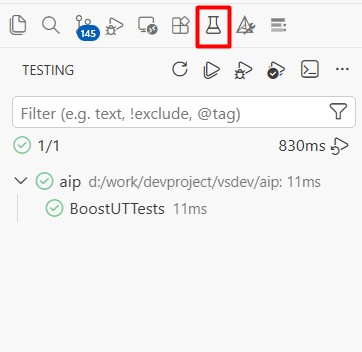

# Модульное тестирование с Boost.Test

Цель лабораторной работы -- научиться писать модульные тесты с помощью фреймворка [Boost.Test](https://www.boost.org/doc/libs/1_80_0/libs/test/doc/html/index.html): организовывать тесты в наборы, использовать проверки разных уровней, фикстуры, тесты, управляемые данными, декораторы, и запускать тесты через CTest и параметры командной строки раннера.

Перед выполнением работы необходимо:

- выполнить лабораторную работу [Базовое модульное тестирование](../../BasicUT/manual/basic_ut.md);
- выполнить лабораторную работу [Подключение сторонних библиотек (SDK): Boost](../../SDK/manual/sdk.md) и собрать через b2 библиотеку **test** в вариантах debug и release.

## Зачем нужен фреймворк

В лабораторной работе [Базовое модульное тестирование](../../BasicUT/manual/basic_ut.md) тестовый раннер был написан вручную: регистрация тестов, подсчет провалов, код завершения. Фреймворк модульного тестирования берет эту работу на себя:

- автоматическая регистрация тестов и генерация функции **main**;
- проверки с понятным сообщением при провале: проверяемое выражение, фактические значения, файл и строка;
- группировка тестов в наборы (test suites) и запуск отдельных тестов или наборов;
- фикстуры -- общая подготовка и очистка данных для группы тестов;
- параметризованные тесты: один тест -- много наборов данных или типов;
- отчеты в разных форматах (в том числе JUnit XML для CI-систем).

Boost.Test -- одна из библиотек Boost. Альтернативы с похожими возможностями: [GoogleTest](https://github.com/google/googletest), [Catch2](https://github.com/catchorg/Catch2), [doctest](https://github.com/doctest/doctest).

## Варианты подключения Boost.Test

| Вариант | Как подключается | Особенности |
|---|---|---|
| Статическая библиотека | `#include <boost/test/unit_test.hpp>`, линковка с **Boost::unit_test_framework** (`link=static`) | Используется в проекте. Фреймворк компилируется один раз при сборке Boost. |
| Динамическая библиотека | То же + макрос **BOOST_TEST_DYN_LINK** (`link=shared`) | Для запуска раннера нужна **.dll** / **.so** рядом с исполняемым файлом или в **PATH** / **LD_LIBRARY_PATH**. |
| Header-only | `#include <boost/test/included/unit_test.hpp>` | Сборка Boost не нужна, но весь фреймворк компилируется в каждой сборке раннера: дольше компиляция. Подключать можно только в **одном** .cpp-файле раннера. |

## Проект BoostUT

Структура проекта:

```
aip
    ...
    BoostUT
        include
            TimeUtils.h         <- интерфейс тестируемого модуля
        manual
            images
            boost_ut.md
        src
            TimeUtils.cpp       <- реализация тестируемого модуля
        tests
            testTimeUtils.cpp   <- тесты
        CMakeLists.txt
    CMakeLists.txt
```

Проект подключен к корневому **CMakeLists.txt**, там же подключен модуль CTest:

```cmake
include(CTest)
...
add_subdirectory(BoostUT)
```

### Тестируемый модуль

Функции перевода **boost::posix_time::ptime** в количество миллисекунд от эпохи Unix и обратно (модуль **NTimeUtils**):

```c++
namespace
{
const auto EPOCH = boost::posix_time::ptime(boost::gregorian::date(1970, 1, 1));
} // namespace

namespace NTimeUtils
{
uint64_t PtimeToMilliseconds(const boost::posix_time::ptime& time) noexcept
{
    if (time.is_not_a_date_time())
        return std::numeric_limits<uint64_t>::max();

    const auto duration = time - EPOCH;
    return static_cast<uint64_t>(duration.total_milliseconds());
}

boost::posix_time::ptime MillisecondsToPtime(uint64_t milliseconds) noexcept
{
    return EPOCH + boost::posix_time::milliseconds(static_cast<int64_t>(milliseconds));
}
} // namespace NTimeUtils
```

### BoostUT/CMakeLists.txt

Полную версию скрипта можно посмотреть в файле [CMakeLists.txt](../CMakeLists.txt).

**1. Поиск Boost.** Так же, как в проекте SDK, Boost ищется в каталоге **WORKSDK** через **find_package** в режиме **CONFIG**. Компонент **unit_test_framework** -- это компилируемая библиотека Boost.Test, поэтому режима header-only здесь нет. Если Boost.Test не собран, проект пропускается с предупреждением, чтобы не ломать конфигурацию остальных проектов репозитория:

```cmake
set(BOOST_COMPONENTS
    unit_test_framework
)

set(Boost_USE_STATIC_LIBS ON)

find_package(Boost ${BOOST_VERSION} EXACT CONFIG QUIET
    COMPONENTS ${BOOST_COMPONENTS}
    HINTS
        "${BOOST_ROOT}/stage" # После "b2 stage"
        "${BOOST_ROOT}"       # После "b2 install --prefix=..."
    NO_DEFAULT_PATH
)

if(NOT Boost_FOUND)
    message(WARNING "BoostUT skipped: ...")
    return()
endif()
```

> Имя компонента в CMake -- **unit_test_framework**, а параметр b2 -- `--with-test`: одна библиотека b2 **test** собирает три файла (**unit_test_framework**, **prg_exec_monitor**, **test_exec_monitor**).

**2. Тестируемый код -- статическая библиотека.** Логика вынесена в библиотеку **BoostUT**, чтобы не компилировать **TimeUtils.cpp** отдельно для каждой цели (приложения, раннера). Заголовок **TimeUtils.h** включает заголовки Boost, поэтому **Boost::headers** подключается как **PUBLIC** -- путь к заголовкам Boost получат и все цели, которые линкуются с **BoostUT**:

```cmake
add_library(BoostUT STATIC
    include/TimeUtils.h
    src/TimeUtils.cpp
)

target_include_directories(BoostUT
    PUBLIC
        ${CMAKE_CURRENT_SOURCE_DIR}/include
)

target_link_libraries(BoostUT
    PUBLIC
        Boost::headers
)
```

**3. Тестовый раннер.** Исполняемый файл, который линкуется с тестируемой библиотекой и с фреймворком. Путь **include** и **Boost::headers** раннер получает транзитивно от **BoostUT**:

```cmake
add_executable(BoostUTRunner
    tests/testTimeUtils.cpp
)

target_link_libraries(BoostUTRunner
    PRIVATE
        BoostUT
        Boost::unit_test_framework
)

add_test(NAME BoostUTTests COMMAND BoostUTRunner)
```

Команда **add_test** регистрирует раннер в CTest -- встроенном инструменте тестирования CMake. После этого тесты запускаются командой **ctest** и появляются в панели Testing в vscode.

## Структура тестового модуля

Минимальный пример:

```c++
#define BOOST_TEST_MODULE MyTestModule
#include <boost/test/unit_test.hpp>

BOOST_AUTO_TEST_SUITE(MyTestSuite)

BOOST_AUTO_TEST_CASE(MyTestCase)
{
    BOOST_TEST(1 + 1 == 2);
}

BOOST_AUTO_TEST_SUITE_END()
```

Тест из проекта:

```c++
#define BOOST_TEST_MODULE TimeUtilsTests
#include <boost/test/unit_test.hpp>
#include "TimeUtils.h"

BOOST_AUTO_TEST_SUITE(TimeUtilsTestSuite)

BOOST_AUTO_TEST_CASE(TestPtimeToMillisecondsEpoch, *boost::unit_test::description("Test conversion of epoch time to milliseconds"))
{
    boost::posix_time::ptime epoch(boost::gregorian::date(1970, 1, 1));
    auto result = NTimeUtils::PtimeToMilliseconds(epoch);
    BOOST_TEST(result == 0u);
}

BOOST_AUTO_TEST_SUITE_END()
```

- `#define BOOST_TEST_MODULE TimeUtilsTests` -- имя тестового модуля. Если макрос определен **до** подключения `<boost/test/unit_test.hpp>`, Boost.Test сам генерирует функцию **main**, которая запускает все тесты. Макрос определяется ровно в одном .cpp-файле раннера; в остальных файлах с тестами подключается только `<boost/test/unit_test.hpp>`. Имя модуля выводится в отчетах.
- `BOOST_AUTO_TEST_SUITE(TimeUtilsTestSuite)` -- начало набора тестов. Наборы группируют тесты одного класса или модуля и могут быть вложенными.
- `BOOST_AUTO_TEST_CASE(name, decorators...)` -- тестовый случай. Слово **AUTO** означает, что тест регистрируется автоматически, без ручного добавления в список. Необязательные декораторы (здесь -- **description**) задают дополнительные свойства теста.
- `BOOST_AUTO_TEST_SUITE_END()` -- конец набора.

## Проверки

### Уровни проверок

Каждая проверка существует в трех уровнях:

| Уровень | Пример | Поведение при провале |
|---|---|---|
| WARN | `BOOST_WARN(x > 0)` | Выводится предупреждение, тест **не** считается проваленным |
| CHECK | `BOOST_CHECK(x > 0)`, `BOOST_TEST(x > 0)` | Тест считается проваленным, выполнение теста **продолжается** |
| REQUIRE | `BOOST_REQUIRE(x > 0)`, `BOOST_TEST_REQUIRE(x > 0)` | Тест считается проваленным, выполнение теста **прерывается** |

**REQUIRE** используется, когда дальнейшие проверки не имеют смысла: например, если вектор пуст, обращение к его первому элементу приведет к неопределенному поведению.

```c++
BOOST_TEST_REQUIRE(!files.empty());
BOOST_TEST(files.front() == "main.cpp");
```

### BOOST_TEST

Универсальный макрос **BOOST_TEST** разбирает выражение и при провале выводит значения обеих частей:

```
testTimeUtils.cpp(19): error: in "TimeUtilsTestSuite/TestPtimeToMillisecondsEpoch": check result == 1u has failed [0 != 1]
```

Старые макросы **BOOST_CHECK_EQUAL(a, b)**, **BOOST_CHECK_NE**, **BOOST_CHECK_LT** и т.п. работают так же, но **BOOST_TEST** предпочтительнее: один макрос для всех операторов сравнения.

> Сравнение знакового и беззнакового значения (`result == 0`, где **result** -- **uint64_t**) приводит к предупреждению компилятора. Используйте литерал нужного типа: `0u`.

### Числа с плавающей точкой

Числа с плавающей точкой сравниваются с допуском (**tolerance**). Допуск в Boost.Test -- **относительный**: `0.001` означает 0.1% от сравниваемых значений.

```c++
namespace tt = boost::test_tools;

BOOST_TEST(Convert(1.0) == 0.45359237, tt::tolerance(1e-9));

// Допуск для всех проверок теста
BOOST_AUTO_TEST_CASE(TestPounds, *boost::unit_test::tolerance(1e-9))
{
    BOOST_TEST(Convert(1.0) == 0.45359237);
}
```

Для сравнения с нулем относительный допуск не работает (любой процент от нуля -- ноль), используйте **BOOST_CHECK_SMALL(value, eps)**.

### Исключения

| Макрос | Проверка |
|---|---|
| `BOOST_CHECK_THROW(expr, ExceptionType)` | выражение бросает исключение указанного типа (или производного от него) |
| `BOOST_CHECK_NO_THROW(expr)` | выражение не бросает исключений |
| `BOOST_CHECK_EXCEPTION(expr, ExceptionType, predicate)` | выражение бросает исключение, и предикат для него возвращает **true** |

```c++
BOOST_CHECK_THROW(FromIsoString("not a date"), std::invalid_argument);

BOOST_CHECK_EXCEPTION(FromIsoString("1969-12-31T23:59:59.000Z"), std::invalid_argument,
    [](const std::invalid_argument& e) { return std::string(e.what()).find("epoch") != std::string::npos; });
```

### Коллекции

Две коллекции сравниваются поэлементно декоратором **tt::per_element()**. При провале выводятся индексы и значения несовпавших элементов:

```c++
std::vector<int> expected{1, 2, 3};
BOOST_TEST(Sort({3, 1, 2}) == expected, tt::per_element());
```

### Сообщения и контекст

```c++
BOOST_TEST_MESSAGE("Processing file " << path);   // выводится при --log_level=message

for (int year : {1970, 2000, 2024})
{
    BOOST_TEST_CONTEXT("year=" << year)            // добавляется к сообщению о провале
    {
        BOOST_TEST(IsLeap(year) == ExpectedLeap(year));
    }
}
```

## Фикстуры

Фикстура (fixture) -- класс, который подготавливает данные перед тестом (конструктор) и освобождает ресурсы после него (деструктор). Для **каждого** теста создается новый экземпляр фикстуры, поэтому тесты не влияют друг на друга. Поля фикстуры доступны в теле теста напрямую.

```c++
struct SEpochFixture
{
    const boost::posix_time::ptime epoch{boost::gregorian::date(1970, 1, 1)};
};

BOOST_FIXTURE_TEST_SUITE(EpochFixtureSuite, SEpochFixture)

BOOST_AUTO_TEST_CASE(TestOneDay)
{
    BOOST_TEST(NTimeUtils::PtimeToMilliseconds(epoch + boost::gregorian::days(1)) == 86'400'000u);
}

BOOST_AUTO_TEST_SUITE_END()
```

| Макрос | Область действия фикстуры |
|---|---|
| `BOOST_FIXTURE_TEST_CASE(name, F)` | один тест |
| `BOOST_FIXTURE_TEST_SUITE(name, F)` | каждый тест набора получает свой экземпляр **F** |
| `BOOST_TEST_GLOBAL_FIXTURE(F)` | один экземпляр на весь запуск раннера: например, создание и удаление временного каталога |

Типичные задачи фикстур: создание временных файлов и каталогов, подготовка объекта в известном состоянии, подмена зависимостей (часов, хранилища) тестовыми реализациями.

## Тесты, управляемые данными

Если одну и ту же проверку нужно выполнить для многих входных значений, вместо копирования тестов используется **BOOST_DATA_TEST_CASE**. Каждый набор данных становится отдельным тестом (**_0**, **_1**, ...), и провал одного не мешает выполнению остальных:

```c++
#include <boost/test/data/test_case.hpp>
#include <boost/test/data/monomorphic.hpp>

namespace bdata = boost::unit_test::data;

BOOST_DATA_TEST_CASE(TestRoundTripData,
    bdata::make({uint64_t{0}, uint64_t{1}, uint64_t{999}, uint64_t{86'400'000}, uint64_t{1'793'914'607'123}}),
    milliseconds)
{
    BOOST_TEST(NTimeUtils::PtimeToMilliseconds(NTimeUtils::MillisecondsToPtime(milliseconds)) == milliseconds);
}
```

Наборы данных можно комбинировать:

| Операция | Пример | Результат |
|---|---|---|
| zip `^` | `bdata::make({1, 2, 3}) ^ bdata::make({"a", "b", "c"})` | пары (1, a), (2, b), (3, c); наборы должны быть одной длины |
| декартово произведение `*` | `bdata::make({1, 2}) * bdata::make({10, 20})` | (1, 10), (1, 20), (2, 10), (2, 20) |
| объединение `+` | `bdata::make({1, 2}) + bdata::make({3})` | 1, 2, 3 |
| диапазон | `bdata::xrange(0, 100, 10)` | 0, 10, ..., 90 |
| случайные значения | `bdata::random(0.0, 1.0) ^ bdata::xrange(100)` | 100 случайных чисел (random бесконечен, поэтому ограничивается zip с конечным набором) |

Пары «вход -- ожидаемый результат» удобно задавать через zip:

```c++
BOOST_DATA_TEST_CASE(TestIsLeap,
    bdata::make({1900, 2000, 2023, 2024}) ^ bdata::make({false, true, false, true}),
    year, expected)
{
    BOOST_TEST(IsLeap(year) == expected);
}
```

## Шаблонные тесты

Если код шаблонный, один тест можно выполнить для нескольких типов:

```c++
#include <tuple>

using TNumericTypes = std::tuple<int, long long, double>;

BOOST_AUTO_TEST_CASE_TEMPLATE(TestCircularBufferPush, T, TNumericTypes)
{
    NBuffers::CCircularBuffer<T> buffer(2);
    buffer.Push(T(1));
    BOOST_TEST(buffer.Size() == 1u);
}
```

## Декораторы

Декораторы задают свойства теста или набора и указываются после имени через `*`:

```c++
namespace utf = boost::unit_test;

BOOST_AUTO_TEST_CASE(TestLargeFile, *utf::label("slow") * utf::timeout(5) * utf::description("Hash 100 MB file"))
{
    ...
}
```

| Декоратор | Назначение |
|---|---|
| `description("...")` | описание теста, выводится в **--list_content** |
| `label("slow")` | метка; тесты с меткой запускаются через `--run_test=@slow` |
| `timeout(N)` | тест считается проваленным, если выполняется дольше **N** секунд |
| `tolerance(eps)` | допуск для всех сравнений чисел с плавающей точкой в тесте |
| `expected_failures(N)` | ожидается ровно **N** проваленных проверок -- для известных, еще не исправленных ошибок |
| `disabled()` / `enabled()` | тест не запускается по умолчанию (но может быть запущен явно через **--run_test**) |
| `depends_on("Suite/Test")` | тест пропускается, если указанный тест провален |

## Конфигурация, сборка и запуск

1. Открыть в vscode **корневую** папку репозитория (aip).
2. Выполнить конфигурацию с помощью CMake. В выводе должна быть строка:

```
[cmake] -- BoostUT: Boost 1.80.0 found: D:/Sdk/worksdk/boost_1_80_0/stage/lib/cmake/Boost-1.80.0
```

Если вместо нее выводится предупреждение `BoostUT skipped: ...`, библиотека Boost.Test не собрана (см. [SDK](../../SDK/manual/sdk.md#сборка-компилируемых-библиотек-b2)).

3. Выполнить сборку цели **BoostUTRunner**.

После конфигурации тесты станут доступны в панели Testing:



### Запуск через CTest

Из каталога **build**:

```
ctest -C Debug --output-on-failure
```

Запуск только тестов BoostUT с подробным выводом:

```
PS D:\Work\aip\build> ctest -V -R BoostUTTests -C Debug
...
1: Test command: D:\Work\aip\build\BoostUT\Debug\BoostUTRunner.exe
1: Running 15 test cases...
1:
1: *** No errors detected
1/1 Test #1: BoostUTTests .....................   Passed    0.01 sec

100% tests passed, 0 tests failed out of 1
```

> CTest видит весь раннер как **один** тест (**BoostUTTests**): он лишь запускает **BoostUTRunner** и проверяет код завершения. Детальную информацию о тестовых случаях выводит сам раннер.

### Параметры раннера

Раннер Boost.Test принимает параметры командной строки:

| Параметр | Назначение |
|---|---|
| `--list_content` | вывести дерево наборов и тестов (с описаниями) без запуска |
| `--run_test=TimeUtilsTestSuite` | запустить набор |
| `--run_test=TimeUtilsTestSuite/TestRoundTripConversion` | запустить один тест |
| `--run_test=*/TestPtime*` | запуск по маске |
| `--run_test=@slow` | запустить тесты с меткой **slow** |
| `--run_test=!@slow` | запустить все тесты, кроме помеченных **slow** |
| `--log_level=test_suite` | выводить вход и выход из каждого теста и время выполнения; другие уровни: **error** (по умолчанию), **warning**, **message**, **all** |
| `--report_level=detailed` | итоговый отчет: сколько проверок и тестов пройдено/провалено в каждом наборе |
| `--log_format=JUNIT --log_sink=report.xml` | отчет в формате JUnit XML для CI-систем (GitHub Actions, GitLab CI, Jenkins) |
| `--random=1` | запускать тесты в случайном порядке -- выявляет скрытые зависимости между тестами |
| `--help` | список всех параметров |

Пример:

```
PS D:\Work\aip\build\BoostUT\Debug> .\BoostUTRunner.exe --run_test=TimeUtilsTestSuite/TestPtimeToMillisecondsEpoch
Running 1 test case...

*** No errors detected
```

```
PS D:\Work\aip\build\BoostUT\Debug> .\BoostUTRunner.exe --list_content
TimeUtilsTestSuite*
    TestPtimeToMillisecondsEpoch*: Test conversion of epoch time to milliseconds
    SpecialValueTest*: Test special values
    ...
EpochFixtureSuite*
    TestOneDay*
    TestLeapDay*
DataDrivenSuite*
    TestRoundTripData*
```

Звездочка после имени означает, что тест включен (enabled).

Параметры можно передать и через CTest:

```cmake
add_test(NAME BoostUTTests COMMAND BoostUTRunner --log_level=test_suite --report_level=short)
```

## Типичные ошибки

| Сообщение | Причина и решение |
|---|---|
| `BoostUT skipped: Boost 1.80.0 with components (unit_test_framework) not found` | Boost.Test не собран через b2 (`--with-test`), или Boost распакован не в WORKSDK. |
| `LNK2038: mismatch detected for 'RuntimeLibrary'` / `'_ITERATOR_DEBUG_LEVEL'` | Debug-раннер линкуется с release-версией Boost.Test. Пересоберите Boost с `variant=debug,release`. При конфигурации CMake выводит предупреждение `debug variant of Boost.Test not found`. |
| `LNK2005: main already defined` / `LNK2019: unresolved external symbol main` | **BOOST_TEST_MODULE** определен в нескольких .cpp-файлах раннера или не определен ни в одном. Макрос должен быть ровно в одном файле. |
| `LNK2019: unresolved external symbol ... boost::unit_test::...` | Раннер не связан с **Boost::unit_test_framework** через **target_link_libraries**. |
| `Cannot open include file: 'TimeUtils.h'` | Раннер не связан с библиотекой **BoostUT**, либо у **BoostUT** путь **include** указан как **PRIVATE**. |
| `Test setup error: no test cases matching filter` | Неверное имя в **--run_test**. Проверьте имена через **--list_content**. |
| `warning C4389: '==': signed/unsigned mismatch` | Сравнение беззнакового значения со знаковым литералом в **BOOST_TEST**. Используйте литерал `0u`. |

## Задания

### Общая часть (выполняется во всех вариантах)

1. Собрать проект **BoostUT** и запустить **BoostUTRunner** в Debug и Release. Приложить к отчету вывод `--list_content`, `--log_level=test_suite` и `ctest -C Debug --output-on-failure`.
2. Реализовать модуль своего варианта в виде статической библиотеки **BoostUT_<Имя>** (файлы **include/<Имя>.h**, **src/<Имя>.cpp**, собственное пространство имен). Тесты варианта разместить в отдельном файле **tests/test<Имя>.cpp**, добавленном в цель **BoostUTRunner**; макрос **BOOST_TEST_MODULE** остается только в одном файле.
3. В тестах варианта обязательно использовать:
   - не менее двух наборов тестов (**BOOST_AUTO_TEST_SUITE**), в том числе вложенный;
   - проверки уровней **CHECK** и **REQUIRE** -- объяснить в отчете, почему в конкретном месте выбран **REQUIRE**;
   - проверку исключений (**BOOST_CHECK_THROW** или **BOOST_CHECK_EXCEPTION**);
   - хотя бы одну фикстуру;
   - хотя бы один тест, управляемый данными (**BOOST_DATA_TEST_CASE**);
   - декораторы **description** и **label**.
4. Продемонстрировать провал теста: внести в код намеренную ошибку, приложить вывод раннера с сообщением **BOOST_TEST** (фактические значения), затем вернуть исправление.
5. Получить отчет в формате JUnit XML (`--log_format=JUNIT --log_sink=report.xml`) и приложить его фрагмент к отчету.
6. Убедиться, что ни файлы Boost, ни каталог **build**, ни **report.xml** не попали в репозиторий, и зафиксировать изменения (commit + push).

### Вариант 1. Календарь и рабочие дни (Boost.Date_Time)

1. Реализовать модуль **NCalendar**:
   - `bool IsLeapYear(int year)`;
   - `int DaysInMonth(int year, int month)` -- для неверного месяца исключение **std::out_of_range**;
   - `int CountWorkdays(boost::gregorian::date from, boost::gregorian::date to)` -- количество рабочих дней (пн--пт) в интервале **[from, to]**; если `from > to` -- исключение **std::invalid_argument**;
   - `boost::gregorian::date AddWorkdays(boost::gregorian::date from, int days)` -- дата через **days** рабочих дней;
   - учет праздников: перегрузки с параметром `const std::set<boost::gregorian::date>& holidays`.
2. Тесты, управляемые данными: **IsLeapYear** для 1900, 2000, 2023, 2024, 2100 (zip «год -- ожидаемый результат»); **DaysInMonth** для всех 12 месяцев високосного и невысокосного года (декартово произведение).
3. Фикстура, содержащая набор праздничных дней года.
4. Проверить, что `CountWorkdays(d, AddWorkdays(d, n))` согласуется с **n** для 100 случайных дат и значений **n** (**bdata::random** + **xrange**). Учесть, что результат зависит от того, рабочий ли день **d**.
5. Не менее **15** тестовых случаев (с учетом наборов данных).

### Вариант 2. Векторная геометрия (числа с плавающей точкой)

1. Реализовать модуль **NGeometry** со структурой `SVector2D { double x, y; }` и функциями: длина вектора, нормализация (нулевой вектор -- исключение **std::domain_error**), скалярное и векторное (псевдоскалярное) произведение, угол между векторами в радианах, поворот на угол, площадь многоугольника по формуле шнурования (менее трех вершин -- исключение **std::invalid_argument**).
2. Все сравнения чисел с плавающей точкой -- только через **tt::tolerance** или **BOOST_CHECK_SMALL**. Объяснить в отчете, почему для сравнения с нулем нельзя использовать относительный допуск.
3. Применить декоратор **tolerance** ко всему набору тестов.
4. Сравнение списков вершин после поворота многоугольника -- поэлементно (**tt::per_element()**; для **SVector2D** определить **operator==** с допуском и **operator<<** для вывода в лог).
5. Тест, управляемый данными: поворот на углы 0, π/2, π, 3π/2, 2π (**xrange** или **make**) и проверка, что длина вектора не меняется.
6. Не менее **12** тестовых случаев.

### Вариант 3. Кольцевой буфер (шаблонные тесты)

1. Реализовать шаблонный класс `NBuffers::CCircularBuffer<T>` фиксированной емкости: **Push** (при заполнении перезаписывает самый старый элемент), **Pop** (пустой буфер -- исключение **std::out_of_range**), **Front**, **Back**, **Size**, **Capacity**, **Empty**, **Full**, **Clear**, итерация от старого элемента к новому (**begin** / **end**). Емкость 0 -- исключение **std::invalid_argument**.
2. Все основные тесты сделать шаблонными (**BOOST_AUTO_TEST_CASE_TEMPLATE**) для типов `int`, `double`, `std::string`.
3. Фикстура, создающая буфер емкости 3 и заполняющая его значениями; фикстурный набор (**BOOST_FIXTURE_TEST_SUITE**) для тестов перезаписи.
4. Сравнение содержимого буфера с ожидаемым вектором -- через **tt::per_element()**.
5. Проверить корректное управление ресурсами: тип-счетчик, который считает живые экземпляры в конструкторах и деструкторе; после **Clear** и после разрушения буфера счетчик равен нулю.
6. Сравнить поведение с **boost::circular_buffer** на одной и той же последовательности операций (тест, управляемый данными).
7. Не менее **12** тестовых случаев.

### Вариант 4. Калькулятор выражений (разбор строк)

1. Реализовать модуль **NCalc** с функцией `double Evaluate(const std::string& expression)`: числа (в том числе дробные), операторы `+ - * /`, унарный минус, скобки, приоритет операций, пробелы между лексемами. Ошибки -- собственный класс исключения **NCalc::CParseError**, производный от **std::runtime_error**, с позицией ошибки в строке (метод **Position()**); деление на ноль -- **std::domain_error**.
2. Тест, управляемый данными: не менее 15 пар «выражение -- результат» (zip двух наборов).
3. Тест, управляемый данными, для некорректных выражений: `""`, `"2+"`, `"(1"`, `"1)"`, `"2**3"`, `"abc"` и т.п. Проверять через **BOOST_CHECK_EXCEPTION**, что позиция ошибки указана верно.
4. Набор «медленных» тестов с меткой **slow** и декоратором **timeout**: выражение из 100000 слагаемых и глубина вложенности скобок 1000. Показать запуск `--run_test=!@slow` и `--run_test=@slow`.
5. Найти (или смоделировать) известную ошибку, покрыть ее тестом с декоратором **expected_failures**, показать вывод раннера, затем исправить ошибку и убрать декоратор.
6. Не менее **12** тестовых случаев (без учета наборов данных).

### Вариант 5. Банковский счет (фикстуры и тестовые двойники)

1. Реализовать модуль **NBank**:
   - интерфейс часов `IClock` (метод `boost::posix_time::ptime Now() const`) и интерфейс журнала `ILogger` (метод `void Write(const std::string&)`);
   - класс **CAccount**, получающий зависимости через конструктор: **Deposit**, **Withdraw** (недостаточно средств -- исключение **NBank::CInsufficientFunds**), **Balance**, **History** (список операций с меткой времени из **IClock**);
   - суточный лимит на снятие: сумма снятий за текущие сутки (по **IClock**) не превышает лимита;
   - функция **Transfer(from, to, amount)**: при ошибке оба счета остаются неизменными.
2. Реализовать тестовые двойники: **CFakeClock** (время задается и сдвигается из теста) и **CSpyLogger** (запоминает все записанные сообщения). Объяснить в отчете, зачем нужны тестовые двойники и почему нельзя тестировать суточный лимит с настоящими часами.
3. Фикстура, создающая счет с начальным балансом, фиктивными часами и журналом; фикстурный набор для операций со счетом.
4. Глобальная фикстура (**BOOST_TEST_GLOBAL_FIXTURE**), которая выводит время начала и окончания запуска тестов.
5. Метод **CAccount::Print(std::ostream&)** -- выписка по счету. Проверить вывод с помощью **boost::test_tools::output_test_stream** (`<boost/test/tools/output_test_stream.hpp>`, метод **is_equal**).
6. Тест **Transfer** зависит от тестов **Deposit** и **Withdraw** (декоратор **depends_on**). Показать, что происходит с ним, если **Withdraw** провален.
7. Не менее **12** тестовых случаев.

## Требования к отчету

1. Номер варианта и ссылка на коммит в личном репозитории.
2. Вывод конфигурации CMake (строка о найденном Boost) и предупреждение, которое выводится, если Boost.Test не собран (временно переименовать каталог Boost).
3. Вывод раннера: `--list_content`, `--log_level=test_suite`, `--report_level=detailed`, запуск отдельного набора и отдельного теста.
4. Пример провала теста с выводом фактических значений.
5. Фрагмент отчета JUnit XML.
6. Вывод **ctest**, где все тесты проходят.
7. Ответы на контрольные вопросы.

## Контрольные вопросы

1. Какие задачи решает фреймворк модульного тестирования по сравнению с тестовым раннером, написанным вручную (лабораторная работа BasicUT)?
2. Чем отличаются варианты подключения Boost.Test: статическая библиотека, динамическая библиотека, header-only? Что нужно для каждого из них?
3. Что делает макрос **BOOST_TEST_MODULE**? Почему он должен быть определен ровно в одном .cpp-файле и до подключения заголовка?
4. Чем отличаются уровни проверок **WARN**, **CHECK** и **REQUIRE**? Приведите пример, когда необходим **REQUIRE**.
5. Почему **BOOST_TEST** предпочтительнее **BOOST_CHECK**? Что выводится при провале каждого из них?
6. Как в Boost.Test сравниваются числа с плавающей точкой? Почему относительный допуск не подходит для сравнения с нулем?
7. Что такое фикстура? Сколько экземпляров фикстуры создается для набора из пяти тестов при использовании **BOOST_FIXTURE_TEST_SUITE**? А при **BOOST_TEST_GLOBAL_FIXTURE**?
8. Чем тест, управляемый данными, лучше цикла внутри одного теста? Чем отличаются операции `^`, `*` и `+` над наборами данных?
9. Почему библиотека **BoostUT** подключает **Boost::headers** как **PUBLIC**, а раннер подключает **Boost::unit_test_framework** как **PRIVATE**? Что изменится, если сделать наоборот?
10. Почему CTest показывает весь раннер как один тест? Как зарегистрировать в CTest отдельные наборы тестов как отдельные тесты?
11. Зачем нужны метки (**label**) и запуск тестов в случайном порядке (**--random**)?
12. Для чего нужен отчет в формате JUnit XML?
