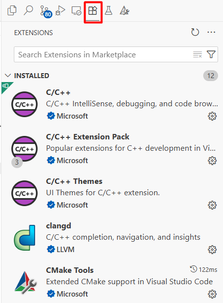
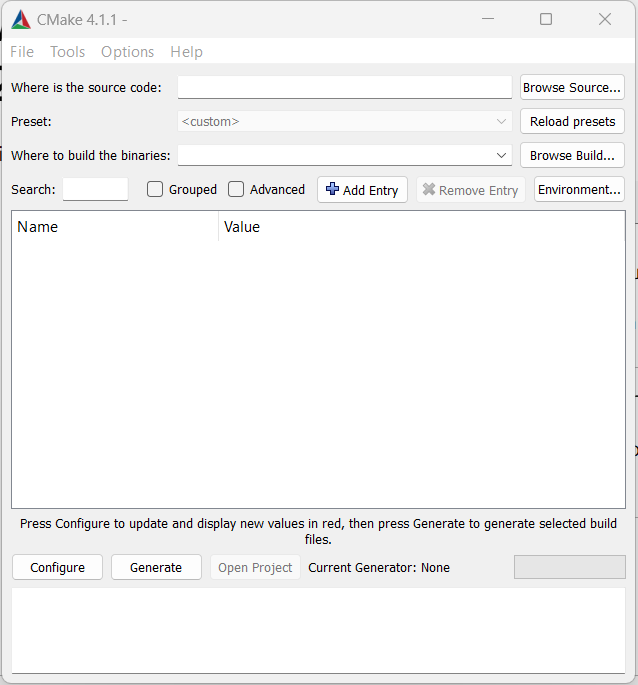
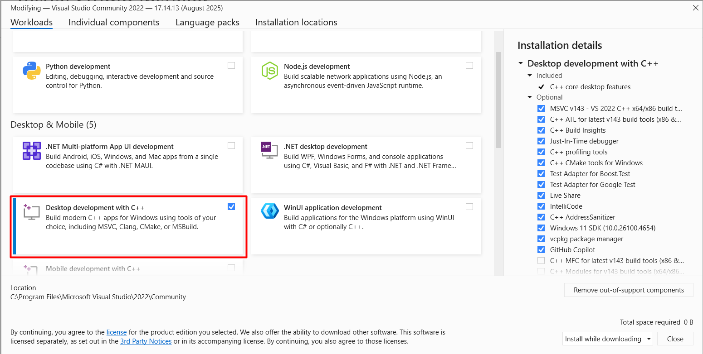
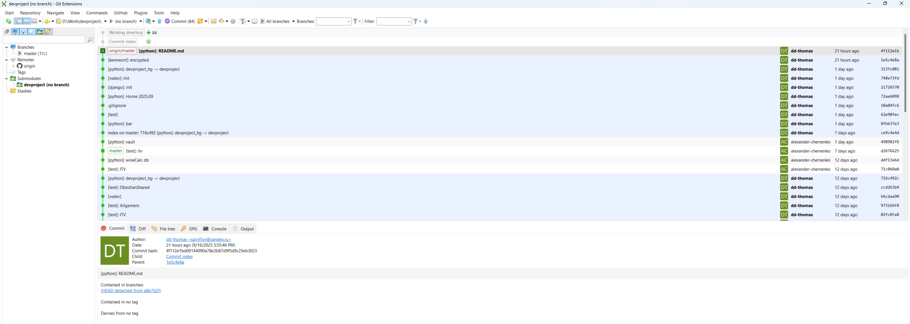
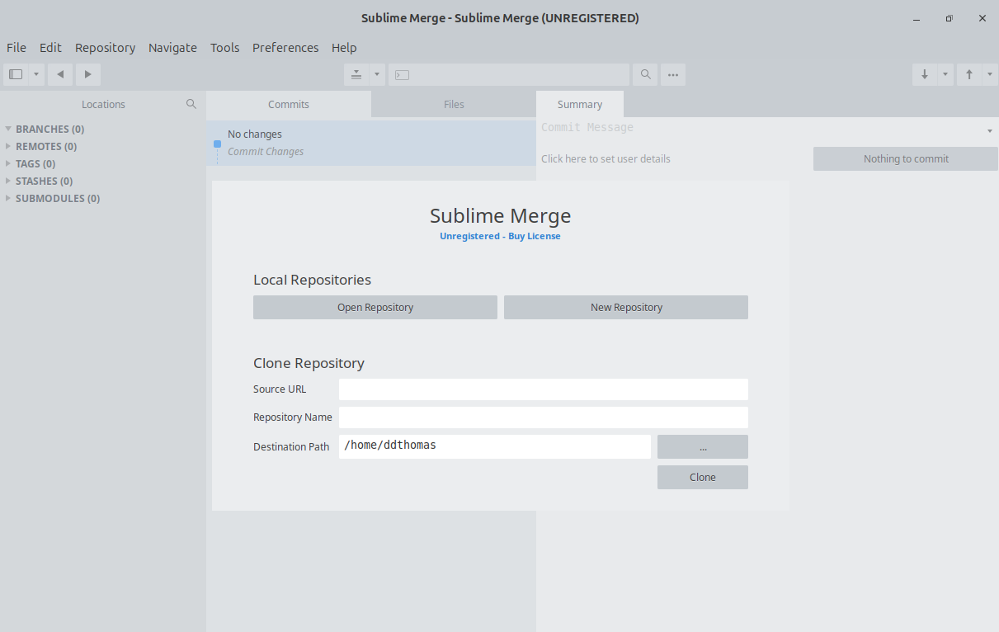
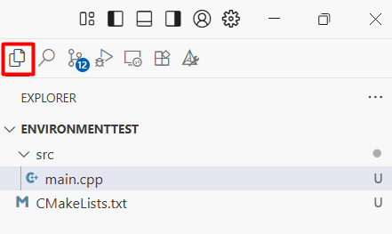
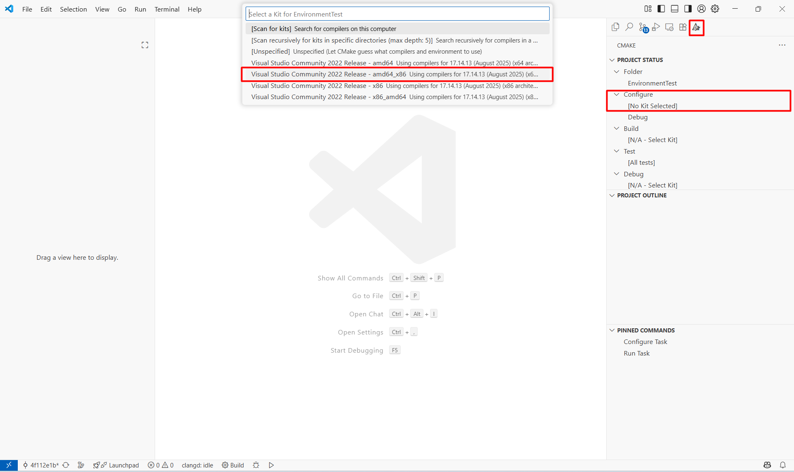
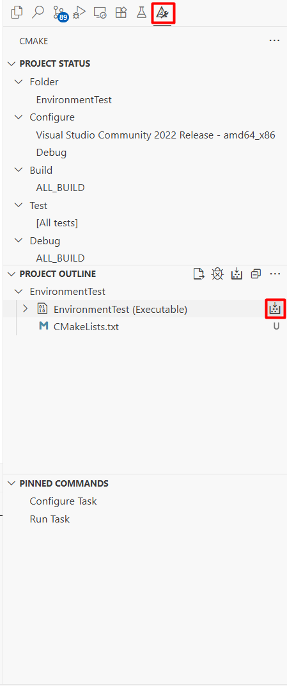
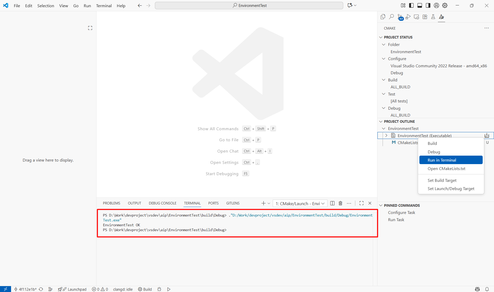
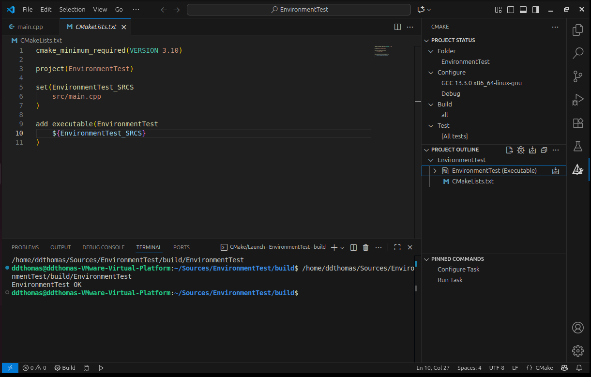

# Настройка окружения под Windows/Linux

Перед выполнением лабораторных работ необходимо зарегистрировать учетную запись на [github](https://github.com/), создать собственный репозиторий. Для работы с репозиторием по SSH необходимо сконфигурировать пару ключей (public-private).

## Windows

### vscode

1. Скачать и установить IDE vscode по [ссылке](https://code.visualstudio.com/)
2. Выполнить установку следующих расширений (вкладка "Extensions", Ctrl + Shift + X):
**C/C++**
**C/C++ Extension Pack**
**C/C++ Themes**
**clangd**
**CMake**
**CMake Tools**



### CMake

1. Скачать и установить CMake по [ссылке](https://cmake.org/):

### Microsoft Visual Studio Community
1. Скачать и установить Visual Studio по [ссылке](https://visualstudio.microsoft.com/ru/vs/)
2. Установить пакет "Desktop development with C++"

### Git
1. Скачать и установить Git по [ссылке](https://git-scm.com/)
2. Скачать и установить Git Extensions по [ссылке](https://gitextensions.github.io/)
3. Склонировать личный репозиторий с github

```
Start
    Clone Repository...
    Repository to clone: <скопировать url репозитория из личного кабинета на github>
    Destination: <указать путь к папке, в которой будут находиться исходники>
    Subdirectory to create: <имя субдиректории будет взято из названия репозитория>
    Branch: (default: remote HEAD)
    Personal repository: Yes
    Initialize all submodules: Yes
    Download full history: Yes
```

После выполнения операции репозиторий будет доступен в клиенте.


## Linux

### vscode

1. Скачать .deb файл vscode по [ссылке](https://code.visualstudio.com/docs/?dv=linux64_deb)
2. Выполнить установку пакета. Пример команды:

```
sudo dpkg -i code_1.104.0-1757488003_amd64.deb
```

3. Выполнить установку следующих расширений (вкладка "Extensions", Ctrl + Shift + X):

**C/C++**
**C/C++ Extension Pack**
**C/C++ Themes**
**clangd**
**CMake**
**CMake Tools**


### Компилятор C++

1. Выполнить установку пакета build-essential:

```
sudo apt install build-essential
```

### CMake

1. В терминале выполнить команду:

```
sudo apt install cmake
```

### Git

1. В терминале выполнить команду:

```
sudo apt install git
```

2. В качестве клиента можно использовать любой доступный. Ниже приведен пример для установки Sublime Merge.
Установка GPG ключа:

```
wget -qO - https://download.sublimetext.com/sublimehq-pub.gpg | gpg --dearmor | sudo tee /etc/apt/trusted.gpg.d/sublimehq-archive.gpg > /dev/null
```

Установка https транспорта:

```
sudo apt-get install apt-transport-https
```

Будем использовать стабильную версию Sublime Merge:

```
echo "deb https://download.sublimetext.com/ apt/stable/" | sudo tee /etc/apt/sources.list.d/sublime-text.list
```

   Обновление репозитория и установка:

```
 sudo apt-get update
 sudo apt-get install sublime-merge
```



## Тестовый проект

Конфигурация, сборка и запуск тестового проекта в настроенном окружении. Структура тестового проекта:

```
EnvironmentTest
    src
        main.cpp
    CMakeLists.txt
```

main.cpp -- исходный код тестового приложения

```
#include <iostream>

int main()
{
    std::cout << "EnvironmentTest OK" << std::endl;

    return 0;
}
```

CMakeLists.txt -- набор правил конфигурации C++ проекта

```
cmake_minimum_required(VERSION 3.10) # Минимальная версия CMake генератора

project(EnvironmentTest) # Наименование проекта

# Список файлов с исходниками
set(EnvironmentTest_SRC
    src/main.cpp
)

# Исходники будут скомпилированы в исполняемый файл
add_executable(EnvironmentTest
	${EnvironmentTest_SRC}
)
```

Первым шагом является конфигурация проекта. Необходимо открыть в vscode папку с исходниками.

Далее выполнить конфигурацию с помощью CMake.

Примерный вывод:

```
[proc] Executing command: "C:\Program Files\CMake\bin\cmake.EXE" --version
[proc] Executing command: "C:\Program Files\CMake\bin\cmake.EXE" -E capabilities
[kit] Successfully loaded 4 kits from C:\Users\alexander.chernenko\AppData\Local\CMakeTools\cmake-tools-kits.json
[variant] Loaded new set of variants
[main] Changes were detected in CMakeLists.txt but we could not reconfigure the project because another operation is already in progress.
[proc] Executing command: chcp
[main] Configuring project: EnvironmentTest 
[proc] Executing command: "C:\Program Files\CMake\bin\cmake.EXE" -DCMAKE_EXPORT_COMPILE_COMMANDS:BOOL=TRUE --no-warn-unused-cli -S D:/Work/devproject/vsdev/aip/EnvironmentTest -B d:/Work/devproject/vsdev/aip/EnvironmentTest/build -G "Visual Studio 17 2022" -T host=x64 -A win32
[cmake] Not searching for unused variables given on the command line.
[cmake] -- Selecting Windows SDK version 10.0.26100.0 to target Windows 10.0.22631.
[cmake] -- The C compiler identification is MSVC 19.44.35215.0
[cmake] -- The CXX compiler identification is MSVC 19.44.35215.0
[cmake] -- Detecting C compiler ABI info
[cmake] -- Detecting C compiler ABI info - done
[cmake] -- Check for working C compiler: C:/Program Files/Microsoft Visual Studio/2022/Community/VC/Tools/MSVC/14.44.35207/bin/Hostx64/x86/cl.exe - skipped
[cmake] -- Detecting C compile features
[cmake] -- Detecting C compile features - done
[cmake] -- Detecting CXX compiler ABI info
[cmake] -- Detecting CXX compiler ABI info - done
[cmake] -- Check for working CXX compiler: C:/Program Files/Microsoft Visual Studio/2022/Community/VC/Tools/MSVC/14.44.35207/bin/Hostx64/x86/cl.exe - skipped
[cmake] -- Detecting CXX compile features
[cmake] -- Detecting CXX compile features - done
[cmake] -- Configuring done (3.7s)
[cmake] -- Generating done (0.0s)
[cmake] -- Build files have been written to: D:/Work/devproject/vsdev/aip/EnvironmentTest/build
```

В результате тестовый проект был сгенерирован в директории **build**. Директорию назначения при желании можно сменить.
Сборка проекта происходит после нажатия на кнопку **Build**

В результате сборки будет создан исполняемый файл **EnvironmentTest**. Его можно запустить из терминала vscode. Вывод программы также отображается в терминале.


Окружение настроено! Можно приступать к выполнению заданий.
