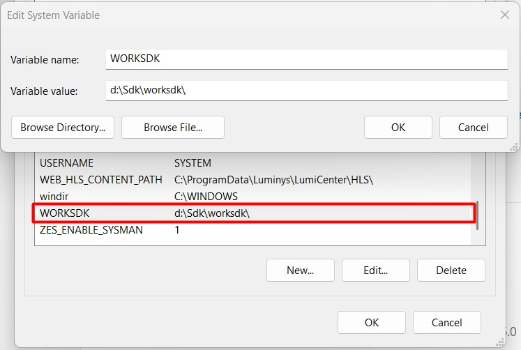

# Подключение сторонних библиотек (SDK): Boost

Цель лабораторной работы -- научиться подключать к C++-проекту сторонние (third-party) библиотеки на примере [Boost](https://www.boost.org/): скачать официальный дистрибутив, при необходимости собрать компилируемые библиотеки, подключить их через CMake и использовать в коде.

Перед выполнением работы необходимо:

- настроить окружение по мануалу [Настройка окружения под Windows/Linux](../../EnvironmentTest/manual/environment.md);
- выполнить лабораторную работу [Базовое модульное тестирование](../../BasicUT/manual/basic_ut.md).

## SDK и переменная окружения WORKSDK

Сторонние библиотеки не хранятся в репозитории проекта: они занимают сотни мегабайт, собираются под конкретный компилятор и обновляются независимо от проекта. Вместо этого все библиотеки складываются в отдельный каталог -- **SDK** (Software Development Kit), а путь к нему записывается в переменную окружения **WORKSDK**. CMake-проекты находят библиотеки относительно этой переменной, поэтому у каждого разработчика SDK может лежать в своем месте.

В примерах ниже SDK расположен в **d:\Sdk\worksdk** (Windows) и **~/sdk/worksdk** (Linux).

### Windows

1. Создать каталог SDK, например **d:\Sdk\worksdk**.
2. Задать переменную окружения (Пуск -- «Изменение переменных среды текущего пользователя»):



   или командой в терминале:

```
setx WORKSDK "d:\Sdk\worksdk"
```

3. Перезапустить vscode, чтобы переменная стала видна CMake.

### Linux

```
mkdir -p ~/sdk/worksdk
echo 'export WORKSDK=$HOME/sdk/worksdk' >> ~/.bashrc
source ~/.bashrc
```

После этого перезапустить vscode.

## Загрузка Boost

1. Открыть страницу [boost.org -- Download](https://www.boost.org/users/download/). В проекте используется версия **1.80.0**; архивы предыдущих версий доступны в разделе [Version History](https://www.boost.org/users/history/) -- страница [Version 1.80.0](https://www.boost.org/users/history/version_1_80_0.html), ссылка **Download**. Прямая ссылка на файлы: [archives.boost.io/release/1.80.0/source](https://archives.boost.io/release/1.80.0/source/).
2. Скачать архив исходников:

| ОС | Файл |
|---|---|
| Windows | boost_1_80_0.zip или boost_1_80_0.7z |
| Linux | boost_1_80_0.tar.bz2 или boost_1_80_0.tar.gz |

3. Распаковать архив в каталог **WORKSDK**.

Windows -- проводником или 7-Zip. Внимание: при распаковке «в папку с именем архива» получается вложенный каталог **boost_1_80_0\boost_1_80_0** -- в этом случае внутренний каталог нужно переместить на уровень выше.

Linux:

```
tar xjf boost_1_80_0.tar.bz2 -C $WORKSDK
```

4. Проверить результат -- должен существовать файл **WORKSDK/boost_1_80_0/boost/version.hpp**. Структура SDK:

```
worksdk                         <- WORKSDK
    boost_1_80_0                <- корень Boost (BOOST_ROOT)
        boost                   <- заголовочные файлы: #include <boost/...>
            date_time
            uuid
            version.hpp
            ...
        doc
        libs                    <- исходники, примеры и документация каждой библиотеки
        tools                   <- исходники сборочной системы b2
        bootstrap.bat
        bootstrap.sh
        index.html              <- документация, открывается в браузере
        stage                   <- появится после сборки (b2 stage)
            lib
                cmake           <- конфигурационные файлы для CMake
                libboost_*.lib / libboost_*.a
```

> Если вы используете другую версию Boost, исправьте значения **BOOST_VERSION** и **BOOST_ROOT** в **SDK/CMakeLists.txt**.

## Header-only и компилируемые библиотеки

Boost -- это не одна библиотека, а набор из ~150 библиотек. По способу подключения они делятся на две группы:

- **header-only** -- весь код находится в заголовочных файлах (как правило, это шаблоны). Для использования достаточно указать компилятору путь к каталогу с заголовками. Сборка Boost не требуется.
- **компилируемые** -- часть кода находится в .cpp-файлах, которые нужно заранее собрать в библиотеку (**.lib** / **.a**) и подключить на этапе линковки.

| Header-only (примеры) | Компилируемые (примеры) |
|---|---|
| Date_Time (с версии 1.73), Uuid, Algorithm, String Algo, Lexical_Cast, Tokenizer, Property_Tree, Optional, Variant, Circular_Buffer, Multi_Index, Regex (с версии 1.76) | Filesystem, Program_Options, Test (Unit Test Framework), Thread, Serialization, JSON, Locale, Iostreams, Log |

Полный список компилируемых библиотек -- в документации [Getting Started](https://www.boost.org/doc/libs/1_80_0/more/getting_started/windows.html#header-only-libraries) или командой `b2 --show-libraries`.

## Сборка компилируемых библиотек (b2)

Для header-only библиотек этот раздел можно пропустить. Для компилируемых библиотек используется сборочная система Boost -- **b2** (Boost.Build). Собирать нужно только те библиотеки, которые требуются проекту: полная сборка занимает десятки минут и несколько гигабайт.

### Windows

1. Открыть **x64 Native Tools Command Prompt for VS 2022** (меню Пуск -- Visual Studio 2022).
2. Выполнить:

```
cd /d %WORKSDK%\boost_1_80_0
.\bootstrap.bat
.\b2 stage --with-program_options --with-filesystem --with-test address-model=64 link=static runtime-link=shared threading=multi variant=debug,release -j8
```

### Linux

```
cd $WORKSDK/boost_1_80_0
./bootstrap.sh
./b2 stage --with-program_options --with-filesystem --with-test link=static threading=multi variant=release -j$(nproc)
```

**bootstrap** собирает саму утилиту **b2** (файл **b2.exe** / **b2** появляется в корне Boost). **b2 stage** собирает библиотеки и складывает их в **stage/lib** вместе с конфигурационными файлами CMake (**stage/lib/cmake**).

Основные параметры b2:

| Параметр | Значение |
|---|---|
| `stage` | собрать библиотеки в каталог **stage/lib** (альтернатива: `install --prefix=<путь>` -- установить заголовки и библиотеки в указанный каталог) |
| `--with-<library>` | собрать только указанную библиотеку; без этого параметра собираются все |
| `address-model=64` | 64-битная сборка |
| `link=static` | статические библиотеки (**libboost_*.lib**); `link=shared` -- динамические (**.dll** + **.lib**) |
| `runtime-link=shared` | динамическая стандартная библиотека C++ (ключи компилятора **/MD**, **/MDd**) -- значение по умолчанию для проектов CMake |
| `variant=debug,release` | собрать отладочный и релизный варианты |
| `-j8` | количество параллельных потоков сборки |

> **Важно (Windows).** Debug- и Release-сборки MSVC используют разные, несовместимые между собой варианты стандартной библиотеки. Если собрать Boost только с `variant=release`, Debug-сборка проекта завершится ошибкой линковки **LNK2038: mismatch detected for 'RuntimeLibrary'**. Поэтому собирайте оба варианта: `variant=debug,release`.

Имена собранных файлов кодируют параметры сборки, например **libboost_program_options-vc143-mt-gd-x64-1_80.lib**:

| Часть имени | Значение |
|---|---|
| `lib` (префикс) | статическая библиотека |
| `boost_program_options` | имя библиотеки |
| `vc143` | компилятор (Visual Studio 2022, toolset v143) |
| `mt` | многопоточная |
| `gd` | отладочная (debug); у release-версии этой части нет |
| `s` | статическая стандартная библиотека C++ (`runtime-link=static`) |
| `x64` | архитектура |
| `1_80` | версия Boost |

## Проект SDK

Структура проекта:

```
aip
    ...
    SDK
        manual
            images
            sdk.md
        src
            main.cpp
        CMakeLists.txt
    CMakeLists.txt
```

Проект подключен к корневому **CMakeLists.txt**:

```
add_subdirectory(SDK)
```

### SDK/CMakeLists.txt

Полную версию скрипта можно посмотреть в файле [CMakeLists.txt](../CMakeLists.txt). Разберем его по частям.

**1. Обязательная переменная окружения.** Без WORKSDK проект не сможет найти библиотеки, поэтому конфигурация сразу завершается с понятной ошибкой:

```cmake
if(NOT DEFINED ENV{WORKSDK})
    message(FATAL_ERROR "Environment variable WORKSDK is not set.")
endif()
```

**2. Расположение и версия Boost.** **file(TO_CMAKE_PATH)** заменяет обратные слеши Windows на прямые:

```cmake
set(BOOST_VERSION "1.80.0")
set(BOOST_ROOT "$ENV{WORKSDK}/boost_1_80_0")
file(TO_CMAKE_PATH "${BOOST_ROOT}" BOOST_ROOT)
```

**3. Список компилируемых библиотек.** Изначально список пуст -- проект использует только header-only библиотеки. Когда понадобится компилируемая библиотека, ее имя добавляется в список (после сборки через b2):

```cmake
set(BOOST_COMPONENTS
    program_options
    filesystem
)
```

**4. Поиск Boost.**

```cmake
set(Boost_USE_STATIC_LIBS ON)

find_package(Boost ${BOOST_VERSION} EXACT CONFIG QUIET
    COMPONENTS ${BOOST_COMPONENTS}
    HINTS
        "${BOOST_ROOT}/stage" # После "b2 stage"
        "${BOOST_ROOT}"       # После "b2 install --prefix=..."
    NO_DEFAULT_PATH
)
```

- **find_package** ищет пакет и создает **импортированные цели** (imported targets) -- например, **Boost::headers**, **Boost::program_options**. Цель содержит все, что нужно для использования библиотеки: путь к заголовкам, путь к файлу библиотеки (свой для Debug и Release), макросы и зависимости.
- **CONFIG** -- искать конфигурационный файл **BoostConfig.cmake**, который генерирует сам Boost при сборке (b2 кладет его в **stage/lib/cmake**). Это современный способ; устаревший модуль **FindBoost** удален из CMake начиная с версии 3.30 (политика **CMP0167**).
- **EXACT** -- требуется именно версия 1.80.0.
- **COMPONENTS** -- какие компилируемые библиотеки нужны. Цели **Boost::<library>** создаются только для перечисленных компонентов.
- **HINTS** + **NO_DEFAULT_PATH** -- искать только в SDK, а не в системных каталогах. Так сборка не зависит от того, установлен ли в системе другой Boost.
- **QUIET** -- не выводить предупреждение, если пакет не найден: эта ситуация обрабатывается ниже.
- **Boost_USE_STATIC_LIBS** -- выбирать статические библиотеки (соответствует `link=static` при сборке b2).

**5. Режим header-only.** Если архив Boost только распакован (b2 не запускался), **BoostConfig.cmake** отсутствует. Если при этом компилируемые библиотеки не требуются, цель **Boost::headers** создается вручную -- это интерфейсная цель, единственное назначение которой -- добавить путь к заголовкам:

```cmake
if(Boost_FOUND)
    message(STATUS "Boost ${Boost_VERSION} found: ${Boost_DIR}")
elseif(NOT BOOST_COMPONENTS AND EXISTS "${BOOST_ROOT}/boost/version.hpp")
    message(STATUS "Boost compiled libraries not found, header-only mode: ${BOOST_ROOT}")
    add_library(Boost::headers INTERFACE IMPORTED)
    target_include_directories(Boost::headers INTERFACE "${BOOST_ROOT}")
else()
    message(FATAL_ERROR "Boost ${BOOST_VERSION} not found in ${BOOST_ROOT}. ...")
endif()
```

**6. Подключение к цели.** Вместо ручного указания путей к заголовкам и библиотекам (**target_include_directories**, **target_link_directories**) цель приложения связывается с импортированными целями Boost. Пути к заголовкам и библиотекам CMake подставит сам:

```cmake
target_link_libraries(SDK
    PRIVATE
        Boost::headers
)
```

Для компилируемых библиотек:

```cmake
target_link_libraries(SDK
    PRIVATE
        Boost::headers
        Boost::program_options
        Boost::filesystem
)
```

## Тестовый пример

Рассмотрим пример использования библиотеки [Boost.Date_Time](https://www.boost.org/doc/libs/1_80_0/doc/html/date_time.html) (заголовок **boost/date_time/posix_time/posix_time.hpp**). Она предоставляет инструменты для работы с моментами времени, их длительностями и интервалами на основе григорианского календаря. Начиная с версии 1.73 библиотека header-only.

Главный класс -- **boost::posix_time::ptime**. Он хранит дату (**boost::gregorian::date**) и время внутри дня (**boost::posix_time::time_duration**) и поддерживает арифметику: разность двух **ptime** -- это **time_duration**.

Функция преобразования **ptime** в количество миллисекунд, прошедших с эпохи Unix (полночь 1 января 1970 года):

```c++
#include <cstdint>
#include <iostream>

#include <boost/date_time/posix_time/posix_time.hpp>

uint64_t to_milliseconds(const boost::posix_time::ptime& time)
{
    static const boost::posix_time::ptime epoch(boost::gregorian::date(1970, 1, 1));
    auto diff = time - epoch;

    return diff.total_milliseconds();
}

int main()
{
    auto now = boost::posix_time::second_clock::local_time();
    std::cout << "ptime=" << now << " milliseconds=" << to_milliseconds(now) << std::endl;

    return 0;
}
```

## Конфигурация, сборка и запуск

1. Открыть в vscode **корневую** папку репозитория (aip).
2. Выполнить конфигурацию с помощью CMake. В выводе должна быть одна из строк:

```
[cmake] -- Boost compiled libraries not found, header-only mode: D:/Sdk/worksdk/boost_1_80_0
```

(архив только распакован) или

```
[cmake] -- Boost 1.80.0 found: D:/Sdk/worksdk/boost_1_80_0/stage/lib/cmake/Boost-1.80.0
```

(библиотеки собраны через b2).

3. Выполнить сборку цели **SDK** и запустить приложение.

Windows:

```
.\build\SDK\Debug\SDK.exe
```

Linux:

```
./build/SDK/SDK
```

Ожидаемый вывод (дата и время -- текущие):

```
ptime=2026-Nov-05 21:36:47 milliseconds=1793914607000
```

Окружение воспроизведено! Можно приступать к выполнению заданий.

## Типичные ошибки

| Сообщение | Причина и решение |
|---|---|
| `Environment variable WORKSDK is not set.` | Не задана переменная WORKSDK или vscode не перезапущен после ее установки. |
| `Boost 1.80.0 not found in .../boost_1_80_0` | Архив распакован не туда (проверьте наличие **boost_1_80_0/boost/version.hpp**, нет ли вложенного каталога **boost_1_80_0/boost_1_80_0**) или в **BOOST_COMPONENTS** указана библиотека, которая не собрана через b2. |
| `Cannot open include file: 'boost/...'` | Цель не связана с **Boost::headers** через **target_link_libraries**. |
| `LNK1104: cannot open file 'libboost_xxx-vc143-mt-gd-x64-1_80.lib'` | Используется компилируемая библиотека, которая не собрана (или собрана без нужного варианта debug/release). Соберите ее через b2 и добавьте в **BOOST_COMPONENTS**. |
| `LNK2038: mismatch detected for 'RuntimeLibrary'` | Debug-проект линкуется с release-версией Boost (или наоборот). Пересоберите Boost с `variant=debug,release`. |
| `LNK2019: unresolved external symbol ... boost::...` | Библиотека компилируемая, но цель не связана с **Boost::<library>**. |

## Задания

### Общая часть (выполняется во всех вариантах)

1. Скачать и распаковать Boost 1.80.0 в WORKSDK, собрать и запустить проект **SDK** в режиме header-only. Приложить к отчету вывод конфигурации CMake и вывод приложения.
2. Собрать через b2 библиотеки **program_options** и **test** (и другие, нужные по варианту) в вариантах debug и release. Добавить их в **BOOST_COMPONENTS**, переконфигурировать проект и убедиться, что CMake нашел **BoostConfig.cmake**.
3. Вынести логику своего варианта в отдельный модуль **src/<Имя>.h / src/<Имя>.cpp** в собственном пространстве имен. **main.cpp** содержит только разбор аргументов и вызов модуля.
4. Реализовать разбор аргументов командной строки консольного приложения с помощью **Boost.Program_options**: обязательная опция `--help`, вывод подсказки при неверных аргументах, ненулевой код завершения при ошибке.
5. Создать тестовый раннер **SDKUTRunner** (**tests/testMain.cpp**) на базе **Boost.Test** (цель **Boost::unit_test_framework**) и зарегистрировать его в CTest:

```c++
#define BOOST_TEST_MODULE SDKTests
#include <boost/test/unit_test.hpp>

BOOST_AUTO_TEST_CASE(ToMillisecondsEpoch)
{
    const boost::posix_time::ptime epoch(boost::gregorian::date(1970, 1, 1));
    BOOST_CHECK_EQUAL(to_milliseconds(epoch), 0u);
}
```

```cmake
add_test(NAME SDKUTRunner COMMAND SDKUTRunner)
```

   Количество тестов -- не менее указанного в варианте. Проверить запуск командой `ctest -C Debug --output-on-failure`.
6. Убедиться, что файлы Boost **не попали** в репозиторий, и зафиксировать изменения (commit + push).

### Вариант 1. Дата и время (Boost.Date_Time)

1. Реализовать API перевода времени (UTC):
   - `uint64_t ToMilliseconds(const boost::posix_time::ptime&)` и обратно `boost::posix_time::ptime FromMilliseconds(uint64_t)`;
   - `std::string ToIsoString(uint64_t ms)` -- строка формата ISO 8601 с миллисекундами: `"2026-11-05T21:36:47.123Z"`;
   - `uint64_t FromIsoString(const std::string&)` -- обратное преобразование; некорректная строка или дата раньше эпохи -- исключение **std::invalid_argument**.
2. Решить ту же задачу средствами стандартной библиотеки **std::chrono** (отдельный модуль с теми же сигнатурами). В тестах проверить, что обе реализации дают одинаковый результат.
3. Реализовать функцию подсчета количества **рабочих дней** (пн--пт) между двумя датами `boost::gregorian::date`, используя **day_iterator** или арифметику дат.
4. Консольное приложение: `SDK --to-iso <ms>`, `SDK --from-iso <string>`, `SDK --workdays <date1> <date2>`.
5. Не менее **12** тестов: эпоха, 29 февраля високосного года, граница года, круговое преобразование `FromIsoString(ToIsoString(x)) == x`, некорректные строки.

### Вариант 2. Идентификаторы и хеши (Boost.Uuid)

1. Реализовать генерацию UUID с помощью **Boost.Uuid**:
   - случайный UUID версии 4 (**random_generator**);
   - UUID версии 5 на основе имени (**name_generator_sha1**, пространство имен **ns::dns**);
   - преобразования UUID ↔ строка (**to_string**, **string_generator**); некорректная строка -- исключение.
2. Реализовать функции `std::string Md5Hex(const std::string&)` и `std::string Sha1Hex(const std::string&)`, возвращающие хеш в виде шестнадцатеричной строки, с помощью **boost::uuids::detail::md5** и **boost::uuids::detail::sha1**. (Обратите внимание: пространство имен **detail** -- внутренняя часть библиотеки, она не входит в документированный интерфейс и может измениться в новых версиях Boost.)
3. Реализовать хеширование файла по частям (блоками по 64 КБ), без загрузки файла в память целиком.
4. Консольное приложение: `SDK --uuid [--count N]`, `SDK --uuid5 <name>`, `SDK --md5 <string>`, `SDK --sha1 --file <path>`.
5. Не менее **10** тестов, в том числе на эталонных значениях из стандартов: MD5 (RFC 1321) и SHA-1 (FIPS 180) для строк `""`, `"abc"`, `"The quick brown fox jumps over the lazy dog"`; проверка версии и варианта UUID (**version()**, **variant()**); неизменность UUID v5 для одного и того же имени; уникальность 10000 случайных UUID.

### Вариант 3. Файловая система (Boost.Filesystem)

1. Собрать через b2 библиотеку **filesystem** и подключить **Boost::filesystem**.
2. Реализовать модуль анализа каталога:
   - общее количество файлов и каталогов, суммарный размер;
   - статистика по расширениям: количество файлов и суммарный размер для каждого расширения;
   - N самых больших файлов;
   - поиск файлов по маске (например, `*.cpp`).
3. Ошибки доступа к отдельным файлам и каталогам не должны прерывать обход: использовать перегрузки с **boost::system::error_code** и выводить список пропущенных путей.
4. Консольное приложение: `SDK --path <dir> [--recursive] [--top N] [--mask <pattern>]`. Вывод -- в виде выровненной таблицы, размеры -- в удобных единицах (Б, КБ, МБ).
5. Реализовать тот же обход с помощью **std::filesystem** (C++17) и сравнить результаты в тестах.
6. Не менее **8** тестов. Тесты создают временную структуру каталогов (**boost::filesystem::temp_directory_path**, **unique_path**) и удаляют ее после выполнения.

### Вариант 4. Обработка текста (String Algo, Tokenizer, Lexical_Cast, Regex)

1. Входные данные -- CSV-файл со списком платежей: `date;email;amount;comment`. Поле **comment** может быть в кавычках и содержать разделитель.
2. Реализовать разбор строки с помощью **boost::tokenizer** и **escaped_list_separator**; удаление пробелов и приведение регистра -- **boost::algorithm::trim**, **to_lower**; преобразование чисел -- **boost::lexical_cast** (с обработкой **bad_lexical_cast**).
3. Реализовать валидацию полей с помощью **Boost.Regex**: дата в формате `YYYY-MM-DD`, корректный email, сумма -- положительное число с не более чем двумя знаками после запятой.
4. Некорректные строки не прерывают обработку: для каждой выводится номер строки и причина ошибки.
5. Консольное приложение: `SDK --input <file.csv> [--group-by email|month]` -- выводит итоговые суммы по группам, отсортированные по убыванию.
6. Не менее **12** тестов: корректные строки, кавычки и разделитель внутри поля, пустые поля, лишние пробелы, неверная дата, неверный email, отрицательная сумма, пустой файл.

### Вариант 5. Конфигурация (Property_Tree, Optional)

1. Описать структуру конфигурации приложения, например:

```c++
struct SConfig
{
    std::string name;
    int port = 8080;
    std::vector<std::string> hosts;
    boost::optional<std::string> logFile; // Необязательный параметр
};
```

2. Реализовать загрузку и сохранение конфигурации в трех форматах с помощью **Boost.Property_Tree**: **JSON** (**json_parser**), **INI** (**ini_parser**), **XML** (**xml_parser**). Формат определяется по расширению файла.
3. Отсутствующие необязательные параметры получают значения по умолчанию (**get_optional**, **get** со значением по умолчанию); отсутствие обязательного параметра или неверный тип значения -- исключение с понятным сообщением (имя параметра и файла).
4. Реализовать валидацию значений: порт в диапазоне 1--65535, непустое имя, корректные адреса в **hosts**.
5. Консольное приложение: `SDK --config <file> [--print] [--convert <file>]` -- загрузка, вывод и конвертация конфигурации из одного формата в другой.
6. Не менее **10** тестов, в том числе круговое преобразование для каждого формата (сохранение -- загрузка -- сравнение), отсутствующие необязательные поля, неверный тип, нарушение диапазона. Объяснить в отчете, почему массив **hosts** нельзя напрямую сохранить в INI-формате, и как вы решили эту проблему.

## Требования к отчету

1. Номер варианта и ссылка на коммит в личном репозитории.
2. Версия Boost, компилятор, команда b2, с которой собирались библиотеки, и список собранных файлов из **stage/lib**.
3. Вывод конфигурации CMake (строка о найденном Boost) в режиме header-only и после сборки b2.
4. Вывод консольного приложения для нескольких наборов аргументов, в том числе с ошибкой.
5. Вывод тестового раннера и **ctest**, где все тесты проходят.
6. Ответы на контрольные вопросы.

## Контрольные вопросы

1. Почему сторонние библиотеки хранятся в отдельном каталоге SDK, а не в репозитории проекта? Какую роль играет переменная окружения **WORKSDK**?
2. Чем header-only библиотека отличается от компилируемой? Приведите по два примера из Boost. Каковы преимущества и недостатки каждого подхода?
3. Что делает команда **bootstrap** и что -- **b2 stage**? Чем **stage** отличается от **install**?
4. Расшифруйте имя файла **libboost_filesystem-vc143-mt-gd-x64-1_80.lib**.
5. Почему Debug-сборка проекта на MSVC не линкуется с release-версией Boost? Как это отражается в ошибке линковщика?
6. Чем статическая линковка с библиотекой отличается от динамической? Что нужно для запуска приложения, собранного с **link=shared**?
7. Что делает команда **find_package** в режиме **CONFIG**? Откуда берется файл **BoostConfig.cmake**?
8. Что такое импортированная цель (**Boost::headers**, **Boost::filesystem**)? Чем подход `target_link_libraries(SDK PRIVATE Boost::filesystem)` лучше ручного указания путей к заголовкам и файлам библиотек?
9. Зачем в **find_package** указаны **HINTS** и **NO_DEFAULT_PATH**? Что может произойти без **NO_DEFAULT_PATH** на компьютере, где Boost установлен в систему?
10. Почему использовать сущности из пространства имен **detail** сторонней библиотеки рискованно?
