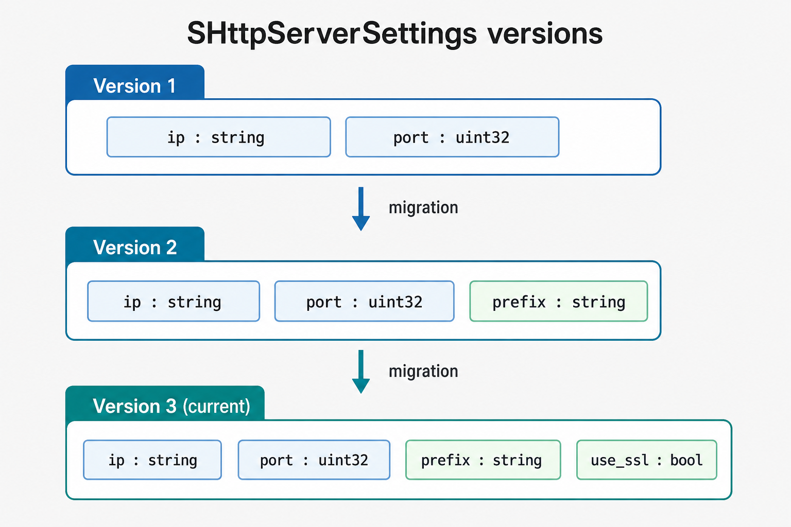
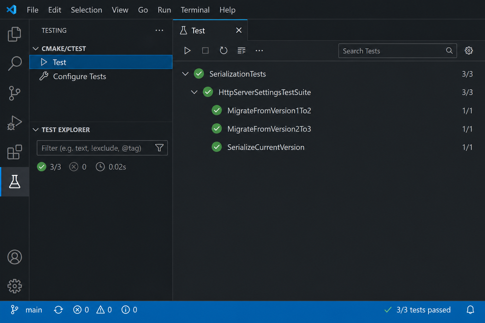

# Сериализация данных с Boost.Serialization

Цель лабораторной работы -- научиться сохранять и загружать C++-объекты с помощью библиотеки [Boost.Serialization](https://www.boost.org/doc/libs/1_80_0/libs/serialization/doc/index.html): описывать сериализацию классов, использовать разные форматы архивов, поддерживать обратную совместимость через версионирование классов и покрывать миграцию данных модульными тестами.

Перед выполнением работы необходимо:

- выполнить лабораторную работу [Модульное тестирование с Boost.Test](../../BoostUT/manual/boost_ut.md);
- выполнить лабораторную работу [Подключение сторонних библиотек (SDK): Boost](../../SDK/manual/sdk.md) и собрать через b2 библиотеки **serialization** и **test** в вариантах debug и release (см. [Сборка Boost.Serialization](#сборка-boostserialization)).

## Зачем нужна сериализация

Сериализация -- преобразование объекта в последовательность байтов или текст (архив), десериализация -- восстановление объекта из архива. Типичные задачи:

- сохранение настроек и состояния приложения между запусками;
- передача объектов по сети или между процессами;
- кеширование результатов вычислений на диске.

Главная практическая сложность -- **эволюция формата**. Структура данных меняется от версии к версии программы, а файлы, сохраненные старыми версиями, должны продолжать читаться. Boost.Serialization решает эту задачу версионированием классов.

Альтернативы с похожими возможностями: [cereal](https://github.com/USCiLab/cereal) (header-only, C++11), [Protocol Buffers](https://protobuf.dev/) и [FlatBuffers](https://flatbuffers.dev/) (описание схемы на отдельном языке, кросс-языковой формат), [nlohmann/json](https://github.com/nlohmann/json) (JSON).

## Архивы

Архив -- объект, в который записываются (**oarchive**, output) или из которого читаются (**iarchive**, input) данные. Формат определяется типом архива, код сериализации класса от формата не зависит:

| Архив | Заголовки | Особенности |
|---|---|---|
| текстовый | `<boost/archive/text_oarchive.hpp>`, `<boost/archive/text_iarchive.hpp>` | числа в текстовом виде через пробел; переносим между платформами |
| XML | `<boost/archive/xml_oarchive.hpp>`, `<boost/archive/xml_iarchive.hpp>` | каждое поле -- XML-элемент с именем; требует **BOOST_SERIALIZATION_NVP**; самый большой и медленный, зато читается и правится человеком |
| бинарный | `<boost/archive/binary_oarchive.hpp>`, `<boost/archive/binary_iarchive.hpp>` | самый компактный и быстрый; **не переносим** между платформами (порядок байтов, размер типов) |

Для всех архивов используются одни и те же операторы:

| Оператор | Где работает | Значение |
|---|---|---|
| `archive << value` | только oarchive | записать |
| `archive >> value` | только iarchive | прочитать |
| `archive & value` | оба вида | записать или прочитать в зависимости от типа архива -- поэтому одна функция **serialize** описывает и сохранение, и загрузку |

> Архив дописывает завершающую часть (для XML -- закрывающий тег `</boost_serialization>`) в **деструкторе**. Поэтому поток можно читать или закрывать только после разрушения архива -- архив создается во вложенном блоке `{ ... }`.

## Проект Serialization

Структура проекта:

```
aip
    ...
    Serialization
        demo
            main.cpp                <- демонстрационное приложение
        include
            HttpServerSettings.h    <- сериализуемая структура
            Serialization.h         <- API сохранения/загрузки
        manual
            images
            serialization.md
        src
            Serialization.cpp       <- реализация API
        test
            assets
                settings_v1.xml     <- эталонные файлы старых версий
                settings_v2.xml
                settings_v3.xml
            testHttpServerSettings.cpp
        CMakeLists.txt              <- самостоятельный CMake-проект
    ...
```

Проект самостоятельный: конфигурируется и собирается отдельно от остальных лабораторных работ и содержит три цели:

| Цель | Тип | Назначение |
|---|---|---|
| **Serialization** | статическая библиотека | сериализуемая структура и API сохранения/загрузки |
| **SerializationUTRunner** | исполняемый файл | модульные тесты (Boost.Test), зарегистрированы в CTest |
| **SerializationDemo** | исполняемый файл | консольное приложение, использующее библиотеку |

Логика вынесена в библиотеку, чтобы раннер и приложение использовали один и тот же скомпилированный код, а не компилировали **Serialization.cpp** каждый отдельно.

### Сборка Boost.Serialization

Boost.Serialization -- компилируемая библиотека. Если при выполнении работы SDK она не была собрана, соберите ее вместе с Boost.Test (Windows, **x64 Native Tools Command Prompt for VS 2022**):

```
cd /d %WORKSDK%\boost_1_80_0
.\b2 stage --with-serialization --with-test address-model=64 link=static runtime-link=shared threading=multi variant=debug,release -j8
```

Linux:

```
cd $WORKSDK/boost_1_80_0
./b2 stage --with-serialization --with-test link=static threading=multi variant=release -j$(nproc)
```

Библиотеки, собранные ранее, пересобираться не будут. Параметр `--with-serialization` собирает две библиотеки: **serialization** (архивы для `char`) и **wserialization** (архивы для `wchar_t`: **xml_woarchive** и т.д.).

### Serialization/CMakeLists.txt

Полную версию скрипта можно посмотреть в файле [CMakeLists.txt](../CMakeLists.txt).

**1. Заголовок проекта.** Как в BoostUT: стандарт C++17, модуль CTest, проверка **WORKSDK**:

```cmake
cmake_minimum_required(VERSION 3.10)

project(Serialization)

set(CMAKE_CXX_STANDARD 17)
set(CMAKE_CXX_STANDARD_REQUIRED ON)

include(CTest)

if(NOT DEFINED ENV{WORKSDK})
    message(FATAL_ERROR "Environment variable WORKSDK is not set.")
endif()
```

**2. Поиск Boost.** Так же, как в SDK и BoostUT, через **find_package** в режиме **CONFIG**. Нужны две компилируемые библиотеки: **serialization** (для библиотеки и приложения) и **unit_test_framework** (для раннера):

```cmake
set(BOOST_COMPONENTS
    serialization
    unit_test_framework
)

set(Boost_USE_STATIC_LIBS ON)

find_package(Boost ${BOOST_VERSION} EXACT CONFIG QUIET
    COMPONENTS ${BOOST_COMPONENTS}
    HINTS
        "${BOOST_ROOT}/stage" # После "b2 stage"
        "${BOOST_ROOT}"       # После "b2 install --prefix=..."
    NO_DEFAULT_PATH
)
```

Если под MSVC не найден debug-вариант Boost.Serialization, выводится предупреждение: Debug-сборка завершится ошибкой **LNK2038** (см. [SDK](../../SDK/manual/sdk.md#сборка-компилируемых-библиотек-b2)).

**3. Библиотека.** Заголовок **HttpServerSettings.h** включает заголовки Boost.Serialization (метод **serialize** -- шаблон и компилируется в коде потребителя), поэтому **Boost::serialization** подключается как **PUBLIC**:

```cmake
add_library(Serialization STATIC
    ${Serialization_HDRS}
    ${Serialization_SRCS}
)

target_include_directories(Serialization
    PUBLIC
        ${CMAKE_CURRENT_SOURCE_DIR}/include
)

target_link_libraries(Serialization
    PUBLIC
        Boost::serialization
)
```

**4. Тестовый раннер.** Путь к эталонным XML-файлам передается в код через макрос препроцессора **SERIALIZATION_ASSETS_DIR**. Так тесты не зависят от текущего рабочего каталога, из которого запущен раннер (vscode, ctest, терминал):

```cmake
add_executable(SerializationUTRunner
    ${Serialization_TEST_SRCS}
)

target_link_libraries(SerializationUTRunner
    PRIVATE
        Serialization
        Boost::unit_test_framework
)

target_compile_definitions(SerializationUTRunner
    PRIVATE
        SERIALIZATION_ASSETS_DIR="${CMAKE_CURRENT_SOURCE_DIR}/test/assets"
)

add_test(NAME SerializationTests COMMAND SerializationUTRunner)
```

**5. Демонстрационное приложение.** Линкуется только с библиотекой **Serialization**:

```cmake
add_executable(SerializationDemo
    ${SerializationDemo_SRCS}
)

target_link_libraries(SerializationDemo
    PRIVATE
        Serialization
)
```

Приложение не указывает ни пути к заголовкам, ни **Boost::serialization**: путь **include** и **Boost::serialization** оно получает транзитивно от цели **Serialization** (**PUBLIC**-зависимости). **Boost::unit_test_framework** приложению не нужен и в него не попадает -- раннер подключает его как **PRIVATE**.

## Сериализуемая структура

Настройки HTTP-сервера имеют три версии схемы данных:



| Версия | Поля |
|--------|------|
| 1 | `ip` (string), `port` (uint32) |
| 2 | + `prefix` (string) |
| 3 (текущая) | + `use_ssl` (bool) |

```c++
#include <boost/serialization/access.hpp>
#include <boost/serialization/nvp.hpp>
#include <boost/serialization/string.hpp>
#include <boost/serialization/version.hpp>

struct SHttpServerSettings
{
    std::string ip;
    std::uint32_t port = 0;
    std::string prefix;
    bool use_ssl = false;

    ...

private:
    friend class boost::serialization::access;

    template <class Archive>
    void serialize(Archive& archive, const unsigned int version)
    {
        archive & BOOST_SERIALIZATION_NVP(ip);
        archive & BOOST_SERIALIZATION_NVP(port);
        if (version >= 2)
        {
            archive & BOOST_SERIALIZATION_NVP(prefix);
        }
        if (version >= 3)
        {
            archive & BOOST_SERIALIZATION_NVP(use_ssl);
        }
    }
};

BOOST_CLASS_VERSION(SHttpServerSettings, 3)
```

- **serialize** -- шаблонный метод, который библиотека вызывает и при сохранении, и при загрузке (оператор `&`). Он может быть закрытым: `friend class boost::serialization::access` дает библиотеке доступ к нему.
- **BOOST_SERIALIZATION_NVP(field)** -- пара «имя -- значение» (name-value pair). Имя попадает в XML как тег (`<ip>`, `<port>`). Для XML-архивов NVP обязательны (иначе ошибка компиляции), текстовые и бинарные архивы имя игнорируют. Если имя тега должно отличаться от имени поля: `boost::serialization::make_nvp("name", field)`.
- **Заголовки поддержки типов.** Каждый тип стандартной библиотеки требует свой заголовок: **std::string** -- `<boost/serialization/string.hpp>`, **std::vector** -- `<boost/serialization/vector.hpp>`, **std::map** -- `<boost/serialization/map.hpp>`, **std::unique_ptr** -- `<boost/serialization/unique_ptr.hpp>` и т.д. Без нужного заголовка -- длинная ошибка компиляции о том, что у класса нет метода **serialize**.

### Версионирование

- **BOOST_CLASS_VERSION(SHttpServerSettings, 3)** -- текущая версия класса. При **сохранении** она записывается в архив (атрибут `version` в XML), а в **serialize** передается `version == 3`.
- При **загрузке** в **serialize** передается версия **из архива**. Для файла версии 1 условия `version >= 2` и `version >= 3` ложны: поля **prefix** и **use_ssl** не читаются и сохраняют значения по умолчанию.
- Если версия в архиве **больше** текущей (файл записан более новой программой), Boost 1.80 **не сообщает об ошибке**: проверка в `boost/archive/detail/iserializer.hpp` отключена (`#if 0`), и в **serialize** просто приходит `version == 4`. Для **SHttpServerSettings** это значит, что поля новой версии (если они записаны в конце) молча игнорируются, а при более сложных изменениях формата загрузка упадет на следующем поле или вернет испорченные данные. Защищаться от этого должен сам класс:

```c++
template <class Archive>
void serialize(Archive& archive, const unsigned int version)
{
    if (version > CURRENT_VERSION)
    {
        throw boost::archive::archive_exception(boost::archive::archive_exception::unsupported_class_version);
    }
    ...
}
```

Правила эволюции формата:

1. Новые поля добавляются только **в конец** и только под условием `if (version >= N)`, где **N** -- новая версия; **BOOST_CLASS_VERSION** увеличивается на 1.
2. Порядок и типы уже существующих полей не меняются: архив читается последовательно, и поле, прочитанное «не на своем месте», -- это ошибка формата или, хуже, молча испорченные данные.
3. Удаленное поле продолжает читаться для старых версий (во временную переменную) и больше не записывается.
4. Если смысл поля изменился (например, таймаут в секундах стал таймаутом в миллисекундах), преобразование выполняется в **serialize** по номеру версии.
5. Для каждой версии формата в тестах хранится **эталонный файл**, записанный той версией программы. Файл, сгенерированный текущим кодом, проверяет только круговое преобразование, но не совместимость.

Атрибуты XML-архива:

```xml
<boost_serialization signature="serialization::archive" version="19">
<settings class_id="0" tracking_level="0" version="1">
```

| Атрибут | Значение |
|---|---|
| `version="19"` у **boost_serialization** | версия формата архивов самой библиотеки (Boost 1.80 -- 19), не путать с версией класса |
| `class_id` | номер класса внутри архива; нужен для указателей и полиморфных типов |
| `tracking_level` | отслеживаются ли адреса объектов этого класса (чтобы объект, на который ссылаются два указателя, сохранился один раз) |
| `version` у **settings** | версия класса из **BOOST_CLASS_VERSION** |

### Неинтрузивная сериализация

Если класс нельзя изменить (сторонняя библиотека), функция **serialize** объявляется свободной в пространстве имен **boost::serialization**. Она имеет доступ только к открытым членам:

```c++
namespace boost::serialization
{
template <class Archive>
void serialize(Archive& archive, SPoint& point, const unsigned int /*version*/)
{
    archive & make_nvp("x", point.x);
    archive & make_nvp("y", point.y);
}
} // namespace boost::serialization
```

Если сохранение и загрузка устроены по-разному (например, поле хранится в одном виде, а записывается в другом), вместо **serialize** пишутся отдельные **save** / **load** и макрос **BOOST_SERIALIZATION_SPLIT_MEMBER()** (для методов класса) или **boost::serialization::split_free** (для свободных функций).

## API библиотеки

```c++
namespace NSerialization
{
bool SaveToXml(const SHttpServerSettings& settings, const std::filesystem::path& filePath);
bool LoadFromXml(SHttpServerSettings& settings, const std::filesystem::path& filePath);
std::string ToXmlString(const SHttpServerSettings& settings);
SHttpServerSettings FromXmlString(const std::string& xml);
} // namespace NSerialization
```

Реализация сохранения в строку:

```c++
std::string ToXmlString(const SHttpServerSettings& settings)
{
    std::ostringstream stream;
    {
        // Архив должен быть разрушен до чтения потока: завершающая часть пишется в деструкторе
        boost::archive::xml_oarchive archive(stream);
        archive << BOOST_SERIALIZATION_NVP(settings);
    }
    return stream.str();
}
```

Имя переменной **settings** становится именем корневого элемента XML (`<settings ...>`). При загрузке имя должно совпасть, иначе -- исключение **xml_archive_exception**.

> **SaveToXml** и **LoadFromXml** возвращают **false**, только если файл не удалось открыть. Ошибки формата (поврежденный файл, неизвестная версия) приводят к исключению **boost::archive::archive_exception** -- его обработка входит в задания.

## Тесты

Рядом с тестами лежит каталог **test/assets** с эталонными XML-файлами всех версий:

- **settings_v1.xml** -- только **ip** и **port** (`version="1"`);
- **settings_v2.xml** -- добавлен **prefix** (`version="2"`);
- **settings_v3.xml** -- добавлен **use_ssl** (`version="3"`).

Пример файла версии 1:

```xml
<?xml version="1.0" encoding="UTF-8" standalone="yes" ?>
<!DOCTYPE boost_serialization>
<boost_serialization signature="serialization::archive" version="19">
<settings class_id="0" tracking_level="0" version="1">
	<ip>192.168.1.10</ip>
	<port>8080</port>
</settings>
</boost_serialization>
```

Тесты из проекта:

```c++
#define BOOST_TEST_MODULE HttpServerSettingsTests
#include <boost/test/unit_test.hpp>

#include "HttpServerSettings.h"
#include "Serialization.h"

BOOST_AUTO_TEST_SUITE(HttpServerSettingsTestSuite)

BOOST_AUTO_TEST_CASE(MigrateFromVersion1To2, *boost::unit_test::description("..."))
{
    const auto xml = readFile(assetPath("settings_v1.xml"));
    const SHttpServerSettings settings = NSerialization::FromXmlString(xml);

    BOOST_TEST(settings.ip == "192.168.1.10");
    BOOST_TEST(settings.port == 8080u);
    BOOST_TEST(settings.prefix.empty());
    BOOST_TEST(settings.use_ssl == false);
}

BOOST_AUTO_TEST_CASE(SerializeCurrentVersion, *boost::unit_test::description("..."))
{
    const SHttpServerSettings original("10.0.0.5", 9443, "/http", true);
    const std::string xml = NSerialization::ToXmlString(original);
    const SHttpServerSettings loaded = NSerialization::FromXmlString(xml);

    BOOST_TEST(loaded.ip == original.ip);
    BOOST_TEST(loaded.port == original.port);
    BOOST_TEST(loaded.prefix == original.prefix);
    BOOST_TEST(loaded.use_ssl == original.use_ssl);
}

BOOST_AUTO_TEST_SUITE_END()
```

- **Миграция 1 → 2 (и далее до 3).** Файл версии 1 читается текущим кодом (версия 3). Поля **prefix** и **use_ssl** отсутствуют в архиве и сохраняют значения по умолчанию.
- **Миграция 2 → 3.** Файл версии 2 содержит **prefix**, но не содержит **use_ssl** -- он остается **false**.
- **Текущая версия.** Объект сохраняется и сразу загружается обратно (круговое преобразование, round-trip): значения всех полей совпадают. Дополнительно читается эталонный **settings_v3.xml**.

Вспомогательные функции **assetPath** и **readFile** находятся в анонимном пространстве имен файла тестов; **readFile** вызывает **BOOST_FAIL**, если эталонный файл не найден.

## Конфигурация, сборка и запуск

1. Открыть в vscode папку **Serialization** (aip/Serialization), а не корень репозитория.
2. Выполнить конфигурацию с помощью CMake. В выводе должна быть строка:

```
[cmake] -- Serialization: Boost 1.80.0 found: D:/Sdk/worksdk/boost_1_80_0/stage/lib/cmake/Boost-1.80.0
```

3. Выполнить сборку. Из терминала (из папки Serialization):

```
cmake -S . -B build
cmake --build build --config Debug
```

После конфигурации тесты станут доступны в панели Testing:



Запуск тестов:

- из панели Testing;
- через CTest из каталога **Serialization/build**:

```
PS D:\Work\aip\Serialization\build> ctest -V -R SerializationTests -C Debug
...
1: Test command: D:\Work\aip\Serialization\build\Debug\SerializationUTRunner.exe
1: Running 3 test cases...
1:
1: *** No errors detected
1/1 Test #1: SerializationTests ...............   Passed    0.71 sec

100% tests passed, 0 tests failed out of 1
```

- раннером напрямую, с параметрами Boost.Test (см. [BoostUT](../../BoostUT/manual/boost_ut.md#параметры-раннера)):

```
PS D:\Work\aip\Serialization\build\Debug> .\SerializationUTRunner.exe --list_content
HttpServerSettingsTestSuite*
    MigrateFromVersion1To2*: Load version 1 settings and verify migration defaults for version 2 fields
    MigrateFromVersion2To3*: Load version 2 settings and verify migration defaults for version 3 fields
    SerializeCurrentVersion*: Round-trip serialize settings in current version 3

PS D:\Work\aip\Serialization\build\Debug> .\SerializationUTRunner.exe --run_test=HttpServerSettingsTestSuite/MigrateFromVersion1To2
Running 1 test case...

*** No errors detected
```

### Демонстрационное приложение

Файл **settings.xml** создается в текущем рабочем каталоге:

```
PS D:\Work\aip\Serialization\build> .\Debug\SerializationDemo.exe
Saved to "D:\Work\aip\Serialization\build\settings.xml":
<?xml version="1.0" encoding="UTF-8" standalone="yes" ?>
<!DOCTYPE boost_serialization>
<boost_serialization signature="serialization::archive" version="19">
<settings class_id="0" tracking_level="0" version="3">
	<ip>127.0.0.1</ip>
	<port>8080</port>
	<prefix>/api</prefix>
	<use_ssl>1</use_ssl>
</settings>
</boost_serialization>

Loaded: ip=127.0.0.1 port=8080 prefix=/api use_ssl=true
```

## Типичные ошибки

| Сообщение | Причина и решение |
|---|---|
| `Environment variable WORKSDK is not set.` | Не задана переменная WORKSDK или vscode не перезапущен после ее установки (см. [SDK](../../SDK/manual/sdk.md#sdk-и-переменная-окружения-worksdk)). |
| `Boost 1.80.0 with components (serialization;unit_test_framework) not found` | Boost.Serialization или Boost.Test не собраны через b2 (`--with-serialization --with-test`). |
| `LNK2038: mismatch detected for 'RuntimeLibrary'` / `'_ITERATOR_DEBUG_LEVEL'` | Debug-сборка линкуется с release-версией Boost. Пересоберите Boost с `variant=debug,release`. При конфигурации CMake выводит предупреждение `debug variant of Boost.Serialization not found`. |
| `'serialize': is not a member of 'std::vector<...>'` (и подобные длинные ошибки шаблонов) | Не подключен заголовок поддержки типа: `<boost/serialization/vector.hpp>`, `<boost/serialization/map.hpp>` и т.д. |
| `static assertion failed` в `xml_oarchive` / `check_object_tracking` / NVP | Для XML-архива поле передано без **BOOST_SERIALIZATION_NVP** / **make_nvp**, либо сохраняется не-**const** объект через указатель с отслеживанием. |
| `unregistered class` | Объект производного класса сохраняется через указатель на базовый, но производный класс не зарегистрирован (**BOOST_CLASS_EXPORT** или **register_type**). |
| `class version ...` (**archive_exception**, код **unsupported_class_version**) | Версия класса в файле больше текущей **BOOST_CLASS_VERSION**: файл записан более новой программой. В Boost 1.80 это исключение бросает только ваш собственный код в **serialize** (см. [Версионирование](#версионирование)). |
| `XML start/end tag mismatch` (**xml_archive_exception**) | Имя NVP при загрузке не совпадает с именем при сохранении, или файл поврежден. |
| `input stream error` | Архив прочитан до конца раньше, чем ожидалось: поток был прочитан до разрушения oarchive (нет завершающей части), или в **serialize** поля читаются не в том порядке / не по той версии. |

## Задания

### Общая часть (выполняется во всех вариантах)

1. Собрать проект **Serialization**, запустить тесты и **SerializationDemo** в Debug и Release. Приложить к отчету вывод конфигурации CMake, `--list_content`, `ctest -C Debug --output-on-failure` и вывод **SerializationDemo**.
2. Добавить в **SHttpServerSettings** версию **4**: поле `std::uint32_t timeout_ms` (значение по умолчанию -- 30000). Сохранить эталонный файл **test/assets/settings_v4.xml**, добавить тест миграции 3 → 4 и обновить тест текущей версии. Убедиться, что тесты для файлов версий 1--3 проходят без изменений.
3. Добавить тесты **SaveToXml** / **LoadFromXml**: запись во временный каталог (**std::filesystem::temp_directory_path**) с удалением файла в фикстуре; загрузка из несуществующего файла возвращает **false**.
4. Подготовить эталонный файл с версией класса больше текущей (например, `version="99"`) и показать, что без дополнительной проверки он загружается без ошибок. Добавить в **SHttpServerSettings::serialize** проверку версии (см. [Версионирование](#версионирование)) и тест: загрузка такого файла приводит к исключению **boost::archive::archive_exception** с кодом **unsupported_class_version** (**BOOST_CHECK_EXCEPTION**).
5. Реализовать модуль своего варианта в библиотеке **Serialization** (файлы **include/<Имя>.h**, **src/<Имя>.cpp**, собственное пространство имен). Тесты варианта разместить в отдельном файле **test/test<Имя>.cpp**, добавленном в цель **SerializationUTRunner**; эталонные файлы -- в **test/assets**. Макрос **BOOST_TEST_MODULE** остается только в одном файле.
6. Расширить **SerializationDemo** (**demo/main.cpp**): приложение демонстрирует сохранение и загрузку данных своего варианта. Объяснить в отчете, почему для этого не нужно добавлять в цель **SerializationDemo** пути к заголовкам и библиотеки Boost.
7. Продемонстрировать нарушение совместимости: временно поменять местами два поля в **serialize** (или убрать условие по версии) и приложить вывод упавших тестов миграции. Вернуть исправление.
8. Убедиться, что ни файлы Boost, ни каталоги **build**, ни файлы, созданные **SerializationDemo**, не попали в репозиторий, и зафиксировать изменения (commit + push).

### Вариант 1. Настройки подключения к базе данных (контейнеры и миграция с преобразованием)

1. Реализовать структуру **SDbSettings**, которая проходит 4 версии формата:
   - v1: `host` (string), `port` (uint16), `user` (string), `timeout` (int, **секунды**);
   - v2: + `std::vector<std::string> replicas` -- адреса реплик;
   - v3: `timeout` заменен на `timeout_ms` (миллисекунды): при загрузке v1--v2 значение умножается на 1000;
   - v4: + `std::map<std::string, std::string> options` -- дополнительные параметры подключения (**sslmode**, **application_name** и т.п.).
2. Для каждой версии сохранить эталонный файл (для v1--v3 -- сгенерировать соответствующей версией кода и зафиксировать в отдельных коммитах) и написать тест миграции до текущей версии.
3. Тест, управляемый данными: круговое преобразование для наборов с пустыми и непустыми **replicas** и **options**, со строками, содержащими символы `<`, `>`, `&`, кавычки и кириллицу. Объяснить в отчете, как XML-архив экранирует спецсимволы.
4. Функции сохранения и загрузки реализовать для XML и текстового архивов (шаблон по типу архива). Сравнить размер файлов.
5. Не менее **10** тестовых случаев.

### Вариант 2. Графический редактор (полиморфизм и указатели)

1. Реализовать иерархию фигур: абстрактный базовый класс **CShape** (цвет, имя, виртуальные **Area()** и **Clone()**) и производные **CCircle**, **CRectangle**, **CPolygon** (`std::vector<SPoint>` вершин). Сцена **CScene** хранит `std::vector<std::unique_ptr<CShape>>`.
2. Сериализация базовой части производных классов -- через **boost::serialization::base_object**; регистрация производных классов -- **BOOST_CLASS_EXPORT_KEY** в заголовке и **BOOST_CLASS_EXPORT_IMPLEMENT** в .cpp. Для абстрактного класса -- **BOOST_SERIALIZATION_ASSUME_ABSTRACT**.
3. Добавить в **CScene** группы фигур: `std::vector<std::shared_ptr<CShape>>`, причем одна фигура может входить в несколько групп. Проверить в тестах, что после загрузки одна и та же фигура в разных группах -- **один объект** (совпадают указатели), и объяснить по XML, как это реализовано (**object_id**, **object_id_reference**).
4. Добавить в **CCircle** версию 2 (поле толщины контура) и эталонный файл сцены версии 1.
5. Тест: сохранение объекта незарегистрированного производного класса приводит к исключению **unregistered_class**.
6. Не менее **10** тестовых случаев.

### Вариант 3. Журнал событий (форматы архивов и производительность)

1. Реализовать структуру события **SEvent**: время (**boost::posix_time::ptime**, заголовок `<boost/date_time/posix_time/time_serialize.hpp>`), уровень (**enum class ELevel**), источник (string), текст (string), атрибуты (`std::map<std::string, std::string>`). Журнал **CEventLog** -- `std::vector<SEvent>` с методами добавления и фильтрации по уровню и интервалу времени.
2. Реализовать шаблонные функции `Save<OArchive>(const CEventLog&, std::ostream&)` и `Load<IArchive>(CEventLog&, std::istream&)` и использовать их с текстовым, XML и бинарным архивами. Бинарный архив открывать в режиме **std::ios::binary** -- объяснить в отчете почему.
3. Тест, управляемый данными: круговое преобразование для всех трех форматов (**bdata::make** по типам архива или **BOOST_AUTO_TEST_CASE_TEMPLATE** по паре типов).
4. Измерить размер архива, время сохранения и загрузки журнала из 10, 1000 и 100000 событий для каждого формата (с помощью методики из работы [Benchmark](../../Benchmark/manual/benchmark.md) или **std::chrono**). Представить результаты таблицей, сделать вывод.
5. Добавить к **SEvent** версию 2 (поле **thread_id**) и проверить чтение эталонных файлов версии 1 во всех трех форматах. Объяснить, почему бинарный эталонный файл непереносим между платформами.
6. Не менее **10** тестовых случаев.

### Вариант 4. Неинтрузивная сериализация и пользовательские типы

1. Дан «сторонний» заголовок **include/ThirdParty.h**, который **нельзя изменять** после создания: структура `SGeoPoint { double lat, lon; }` и класс **CIpAddress** с закрытым полем `std::uint32_t` и открытыми методами `ToString()` / `static CIpAddress FromString(const std::string&)`.
2. Реализовать неинтрузивную сериализацию:
   - **SGeoPoint** -- свободная функция **serialize**;
   - **CIpAddress** -- через **split_free**: в архив записывается строка вида `"192.168.0.1"`, а не число; некорректная строка при загрузке -- исключение.
3. В Boost 1.80 нет поддержки **std::optional** и **std::variant** (есть только **boost::optional** и **boost::variant**). Реализовать сериализацию `std::optional<T>` (через **split_free**: флаг наличия значения + значение) и проверить ее на `std::optional<int>`, `std::optional<std::string>`, `std::optional<SGeoPoint>`.
4. Реализовать структуру **SDevice** (имя, `CIpAddress`, `std::optional<SGeoPoint>` местоположения, `std::optional<std::string>` описания) с версией 2, в которой добавлено поле `std::optional<CIpAddress> gateway`.
5. Тест, управляемый данными: круговое преобразование **CIpAddress** для граничных адресов (`0.0.0.0`, `255.255.255.255`, ...) и некорректных строк (`"256.0.0.1"`, `"1.2.3"`, `""`).
6. Не менее **10** тестовых случаев.

### Вариант 5. Профили пользователей (надежная загрузка и резервные копии)

1. Реализовать структуру **SUserProfile**: логин, роль (**enum class ERole** -- сериализуется как число; объяснить в отчете, почему нельзя менять порядок элементов перечисления), список избранного (`std::vector<std::string>`), настройки (`std::map<std::string, int>`). Хранилище **CProfileStore** -- `std::map<std::string, SUserProfile>` по логину.
2. Реализовать надежное сохранение: запись во временный файл и последующая замена основного (**std::filesystem::rename**), предыдущая версия файла сохраняется как **.bak**. Объяснить в отчете, от какой проблемы защищает такая схема.
3. Реализовать функцию `LoadOrDefault(path)`: при отсутствии файла -- пустое хранилище; при поврежденном файле -- попытка загрузки из **.bak**; если и она неуспешна -- исключение с описанием обеих ошибок. Перехватывать **boost::archive::archive_exception**, а не `catch (...)`.
4. Тест, управляемый данными, на некорректных файлах из **test/assets**: пустой файл, обрезанный файл, неверный корневой тег, нечисловое значение роли, версия класса из будущего. Для каждого -- ожидаемый тип исключения или результат загрузки из **.bak**.
5. Добавить к **SUserProfile** версию 2 (поле времени последнего входа) с эталонным файлом версии 1.
6. Не менее **12** тестовых случаев.

## Требования к отчету

1. Номер варианта и ссылка на коммит в личном репозитории.
2. Команда b2, с которой собирались Boost.Serialization и Boost.Test, и вывод конфигурации CMake.
3. Фрагменты эталонных XML-файлов всех версий своих структур с пояснением атрибутов.
4. Вывод раннера: `--list_content`, `--log_level=test_suite`, запуск тестов своего варианта.
5. Пример нарушения совместимости (общая часть, п. 7) с выводом упавших тестов.
6. Вывод **SerializationDemo** и **ctest**, где все тесты проходят.
7. Ответы на контрольные вопросы.

## Контрольные вопросы

1. Что такое сериализация и десериализация? Приведите три практические задачи, где они нужны.
2. Чем отличаются текстовый, XML и бинарный архивы Boost.Serialization? Какой формат выбрать для файла настроек, для кеша на диске, для передачи данных между Windows и Linux?
3. Почему одной функции **serialize** с оператором `&` достаточно и для сохранения, и для загрузки? В каких случаях нужны раздельные **save** / **load**?
4. Зачем нужен `friend class boost::serialization::access`? Как сериализовать класс, исходный код которого нельзя изменить?
5. Что делает **BOOST_SERIALIZATION_NVP**? Почему без него не компилируется сохранение в XML-архив, но компилируется в текстовый?
6. Как работает **BOOST_CLASS_VERSION**? Откуда берется значение параметра **version** в **serialize** при сохранении и при загрузке?
7. Сформулируйте правила, которые нужно соблюдать при добавлении, удалении и изменении смысла полей, чтобы старые файлы продолжали читаться. Что произойдет, если поменять порядок двух полей?
8. Что произойдет в Boost 1.80 при загрузке файла, записанного более новой версией программы? Почему это опасно, как защититься и как приложение должно обрабатывать такую ситуацию?
9. Почему тесты миграции используют эталонные файлы из **test/assets**, а не файлы, сгенерированные текущим кодом в самом тесте?
10. Почему архив создается во вложенном блоке `{ ... }` и что произойдет, если прочитать **std::ostringstream** до разрушения **xml_oarchive**?
11. Что означают атрибуты `class_id`, `tracking_level` и `version` в XML-архиве? Чем `version="19"` в теге **boost_serialization** отличается от версии класса?
12. Как Boost.Serialization сохраняет объекты, на которые ссылаются несколько указателей? Зачем нужна регистрация производных классов (**BOOST_CLASS_EXPORT**)?
13. Почему библиотека **Serialization** подключает **Boost::serialization** как **PUBLIC**? Что изменится, если подключить ее как **PRIVATE**?
14. Зачем код сериализации вынесен в статическую библиотеку, а не добавлен исходными файлами в **SerializationUTRunner** и **SerializationDemo**? Почему **SerializationDemo** не линкуется с **Boost::unit_test_framework**, хотя библиотека и раннер находятся в одном проекте?
15. Зачем путь к эталонным файлам передается в тесты через **target_compile_definitions** (**SERIALIZATION_ASSETS_DIR**), а не задается относительным путем в коде?
